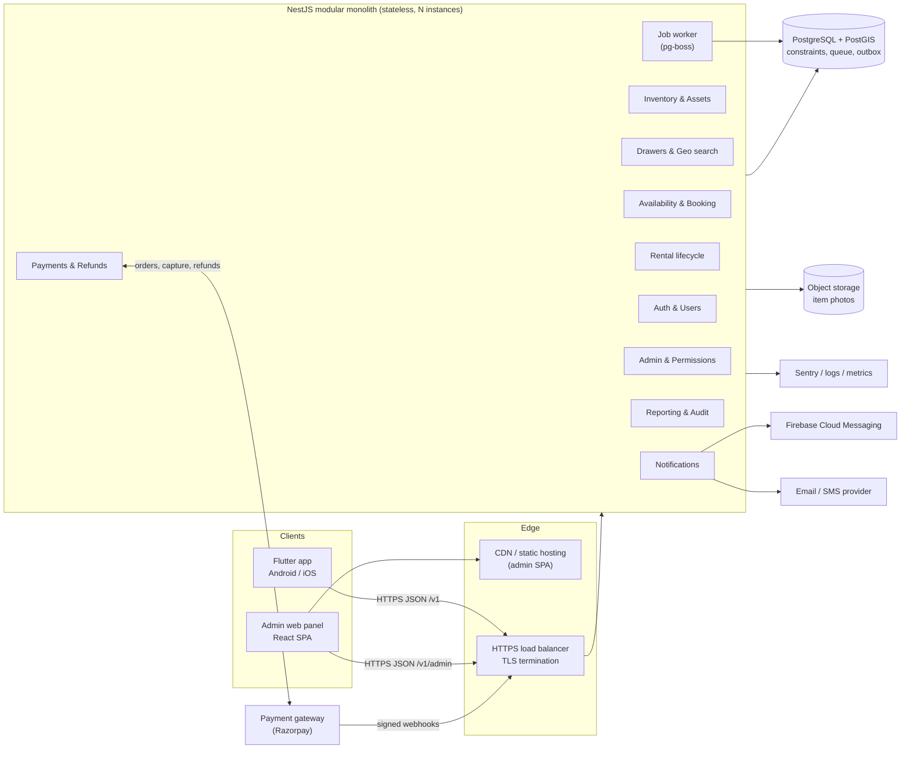
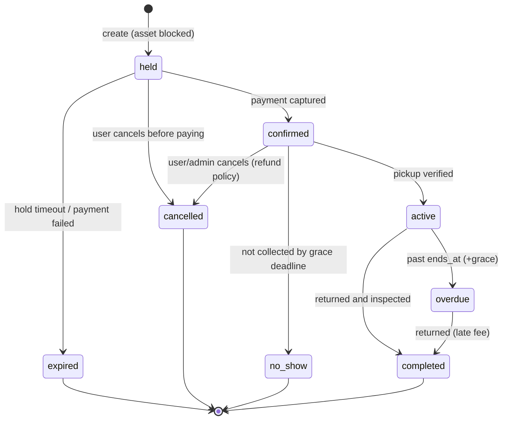
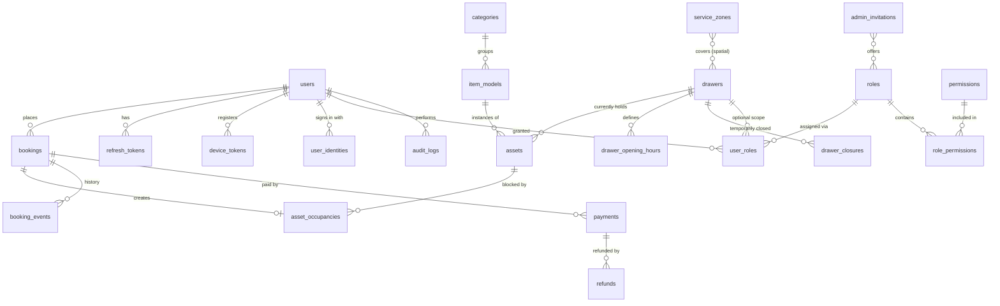
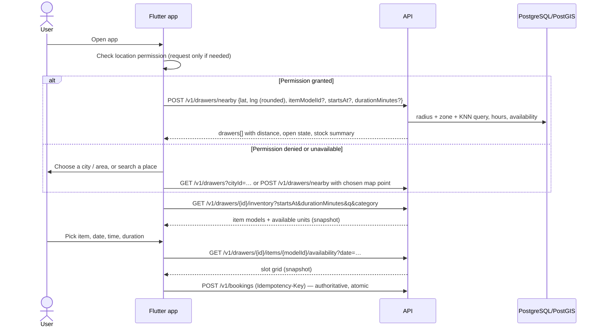
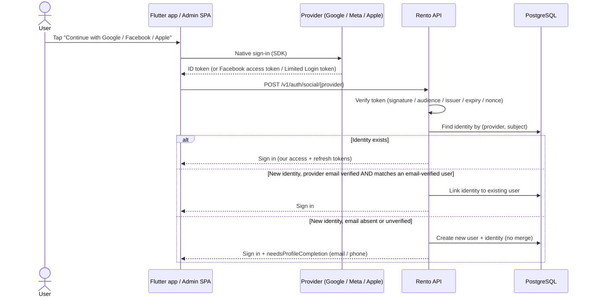

# Rento — Time-Based Rental Platform

> Rent physical items (PlayStation consoles, cameras, projectors, …) by the hour from the nearest **drawer** — a physical inventory location — with a booking engine that **cannot** double-book a physical unit.

| | |
|---|---|
| **Status** | Research & architecture complete — **no application code exists yet**. This README is the source of truth for implementation. |
| **Document date** | 2026-10-10 |
| **Targets** | Flutter (Android + iOS) customer app · React admin web panel · TypeScript/NestJS API · PostgreSQL + PostGIS |
| **Initial market** | A single Indian city / service area, designed to expand to many |
| **Companion document** | [DEVELOPMENT_PLAN.md](DEVELOPMENT_PLAN.md) — the step-by-step, test-gated task tracker an AI agent follows to build this (tick boxes = implemented **and** tested). |
| **Revision** | r2 (2026-10-10): added custom **roles & permissions** with Super Admin (§13.5), **Google / Meta / Apple login** (§15.1), unified identity model, new tests/roadmap/ADRs. r1 was the initial research. |

### How to read this document

Every claim is tagged so you can tell evidence from opinion:

| Tag | Meaning |
|---|---|
| ✅ **Verified** | Checked against official docs or reproduced in a test during this research pass (2026-10-10). |
| 🧭 **Recommendation** | Architectural judgment. Reasoned, but another team could reasonably choose differently. |
| ❓ **Assumption / Unverified** | Not confirmed. Must be validated before it is relied on (prices, vendor behaviour, business rules). |

**What was actually verified** (so you can calibrate trust):

- ✅ PostgreSQL exclusion constraints, range types, `[)` bounds, `btree_gist`, and isolation-level/retry behaviour — read in the [official docs](#20-references).
- ✅ **The core booking guarantee was reproduced.** The schema in [§9](#9-conflict-prevention-strategy) was run on `postgis/postgis:16-3.4`: an overlapping insert failed with SQLSTATE `23P01`, an adjacent insert succeeded, and **30 concurrent transactions inserting the identical slot resulted in exactly 1 success and 29 failures, leaving exactly 1 row**. The `ST_DWithin` + KNN nearby-drawer query (without the service-zone clause, which is untested) and the `FOR UPDATE SKIP LOCKED` claim query were also executed.
- ✅ PostGIS `ST_DWithin` / KNN `<->` behaviour (docs), Razorpay capture/auto-refund settings (docs), Supabase and DigitalOcean list prices (vendor pages), Neon region list (docs).
- ❓ No backend benchmarks were run. Framework comparisons in [§4.1](#41-backend-framework) are qualitative; this workload is database-bound, so framework throughput is not the deciding factor.
- ❓ All INR costs in [§17](#17-deployment-and-cost) are **unverified estimates**.

---

## Table of contents

1. [Project overview and goals](#1-project-overview-and-goals)
2. [Product scope and business rules](#2-product-scope-and-business-rules)
3. [MVP features and future features](#3-mvp-features-and-future-features)
4. [Technology comparisons](#4-technology-comparisons)
5. [Final recommended stack](#5-final-recommended-stack)
6. [Architecture overview](#6-architecture-overview)
7. [Booking sequence and lifecycle](#7-booking-sequence-and-lifecycle)
8. [Database design and core entities](#8-database-design-and-core-entities)
9. [Conflict-prevention strategy](#9-conflict-prevention-strategy)
10. [Nearby-drawer discovery](#10-nearby-drawer-discovery)
11. [Flutter architecture](#11-flutter-architecture)
12. [Backend modules and repository structure](#12-backend-modules-and-repository-structure)
13. [Admin panel architecture](#13-admin-panel-architecture)
14. [API design and endpoint catalog](#14-api-design-and-endpoint-catalog)
15. [Authentication and security](#15-authentication-and-security)
16. [Testing strategy](#16-testing-strategy)
17. [Deployment and cost](#17-deployment-and-cost)
18. [Development roadmap](#18-development-roadmap)
19. [Assumptions, risks, open questions, ADRs](#19-assumptions-risks-open-questions-and-architecture-decisions)
20. [References](#20-references)

---

## 1. Project overview and goals

Users open the app, share their location (or pick a place manually), see the nearest **eligible drawer**, choose an item (e.g. PlayStation 5), pick a date, start time and duration, and book. The backend guarantees that the specific physical unit assigned to them is not simultaneously assigned to anyone else. Staff manage everything from a web admin panel.

**Goals**

1. **Never double-book a physical unit.** Enforced by the database, not by application checks (§9).
2. **Model physical reality.** Every rentable unit is an individually identified *asset* (`PS5-001`, `PS5-002`) with its own availability, maintenance state and location history.
3. **Location-aware discovery.** Show inventory from nearby drawers that are actually usable (open, in service area, has stock) — not merely the closest dot on a map (§10).
4. **Small-team operability.** One deployable backend, one database, boring technology. Grow by extracting, not by starting distributed.
5. **Production-grade from the first real booking:** idempotent APIs, audited admin actions, tested concurrency, backups, monitoring (§15–§17).

**Non-goals (initially):** multi-vendor marketplace, delivery logistics, dynamic/surge pricing, IoT lock integration, web customer app.

**Terminology**

| Term | Meaning |
|---|---|
| **Drawer** | A physical inventory location (kiosk/locker/shelf/shop) with coordinates, hours and a timezone. |
| **Item model** (catalog item) | A product definition: "PlayStation 5 Slim", price, rules, photos. |
| **Asset** | One physical unit of an item model, with a unique code (`PS5-001`). Lives at one drawer at a time. |
| **Occupancy** | A time interval during which an asset is unavailable (a booking, maintenance, transfer, admin block). |
| **Hold** | A short-lived reservation (≈10 min) that blocks the asset while the user pays. |
| **Rental window** | `[starts_at, ends_at)` — half-open interval: start inclusive, end exclusive. |

---

## 2. Product scope and business rules

These are **proposed defaults** (🧭). Items needing owner sign-off are collected in [§19.3](#193-unresolved-business-questions-need-your-decision).

| # | Rule | Default |
|---|---|---|
| BR-1 | A physical asset can have **at most one active occupancy at any instant**. | Hard invariant, DB-enforced. |
| BR-2 | Intervals are half-open `[start, end)`. A booking ending 11:00 and one starting 11:00 do **not** conflict. | Yes, unless a buffer is configured. |
| BR-3 | Users book an **item model at a drawer**; the system assigns a specific free asset. Users do not choose `PS5-002` over `PS5-001`. | Auto-assign (admin may reassign). |
| BR-4 | A rental must lie fully inside the drawer's operating hours (drawer-local time) and outside temporary closures. | Enforced at booking time. |
| BR-5 | Duration is a multiple of the model's **slot granularity** within `[min_duration, max_duration]`. | 30 min granularity, 30 min–8 h (configurable per model). |
| BR-6 | A **buffer** (cleaning/inspection) may follow each rental: the asset stays blocked for `[ends_at, ends_at + buffer)`. | 0–15 min, per model. |
| BR-7 | Booking lead time & horizon. | Min 15 min ahead; max 14 days ahead. |
| BR-8 | A hold lasts 10 minutes. Unpaid holds expire and release the asset. | 10 min. |
| BR-9 | Cancellation refund tiers are configuration, not code. | e.g. ≥24 h: 100 % · 2–24 h: 50 % · <2 h: 0 % (placeholder). |
| BR-10 | Late return is billed per extra slot; extension is allowed only if the asset is free for the extra time. | Yes. |
| BR-11 | Users see only drawers within their search radius **and** inside a serviceable zone. | 5 km default, configurable. |
| BR-12 | Admins may not hard-delete assets/bookings/drawers with history; they **deactivate** them. | Soft state only. |
| BR-13 | Every admin mutation of inventory/bookings is audit-logged with actor, reason, before/after. | Mandatory. |
| BR-14 | Money is stored as integer **paise** with a currency code (INR). | Never floats. |
| BR-15 | Timestamps are stored as UTC `timestamptz`; display uses the **drawer's** IANA timezone. | Mandatory. |
| BR-16 | Admin access is granted **only** through roles. A role is a named set of permissions from a fixed, code-defined catalog. A user has admin access iff they hold ≥1 role. | Mandatory. |
| BR-17 | **Super Admin** is a locked system role holding every permission (including future ones). Only a Super Admin can grant it; at least one active Super Admin must always exist. | Mandatory. |
| BR-18 | No privilege escalation: a granter can only create/assign roles whose permissions are a subset of their own; nobody can change their own roles. | Mandatory. |
| BR-19 | A user may have several sign-in methods (password, Google, Meta, Apple) on one account, but must always retain at least one. A provider-supplied email is trusted for account linking only if the provider marks it **verified**. | Mandatory. |

---

## 3. MVP features and future features

### 3.1 Customer app

| Feature | MVP | Later |
|---|:---:|:---:|
| Register / login / logout / refresh / password reset / delete account | ✅ | |
| Phone-OTP login (very common in India — see [Q-1](#193-unresolved-business-questions-need-your-decision)) | ❓ | ✅ |
| **Login with Google** (Android, iOS) | ✅ | |
| **Login with Meta / Facebook** (Android, iOS; Limited Login on iOS) | ✅ | |
| **Sign in with Apple** (iOS) — required by App Store rule 4.8 once Google/Facebook login is offered, see [§15.1](#151-social-login-google-meta-apple) | ✅ | |
| Link / unlink sign-in methods in profile | ✅ | |
| Location permission flow + manual location/city fallback | ✅ | |
| Nearby drawer discovery (radius + ranking + eligibility) | ✅ | |
| Search, category browse, filter, sort | ✅ | Saved searches, favourites |
| Item detail: photos, price, rules, deposit, hours | ✅ | Reviews & ratings |
| Date / start time / duration selection with slot availability | ✅ | |
| Availability freshness | Refetch on focus + short polling | Live push via SSE/WebSocket |
| Book (hold → pay → confirm), view, cancel | ✅ | |
| Booking history + detail (status, pickup code, return info) | ✅ | |
| Pickup via time-bound code/QR shown in app; return instructions | ✅ | Smart-lock/IoT unlock |
| Extension / early return | ✅ (extension) | Early-return refunds |
| Push notifications (confirmation, reminder, return due, overdue) | ✅ | Marketing, preferences |
| Payments (UPI/cards/netbanking via a gateway) | ✅ (gate for real bookings) | Wallets, coupons, subscriptions |
| Offline/error states, retry | ✅ | Offline booking drafts |

### 3.2 Admin web panel

| Feature | MVP | Later |
|---|:---:|:---:|
| Item-model CRUD, photos, pricing & rules | ✅ | Bulk import |
| Asset register (unique IDs, status, serial, notes) | ✅ | QR labels, depreciation |
| Drawer CRUD with map pin, hours, closures | ✅ | Service-zone polygon editor |
| Assign assets to drawers; safe transfers | ✅ | Transfer logistics workflow |
| Pricing, durations, buffers, deposits | ✅ | Time-of-day / demand pricing |
| Booking calendar (per asset / per drawer) | ✅ | Drag-and-drop rescheduling |
| Cancel / reassign / resolve bookings with reasons | ✅ | |
| Maintenance & unavailable periods | ✅ | Recurring maintenance schedules |
| User management (view, suspend) | ✅ | Support tooling, notes |
| **Custom roles & permissions**: Super Admin creates roles from a permission matrix and assigns them to admins; each admin sees/does only what their role allows ([§13.5](#135-roles-permissions-and-the-super-admin)) | ✅ | Approval workflows for sensitive actions |
| Admin invitations (email + role), promote an existing user to admin, deactivate admins | ✅ | |
| Drawer-scoped roles (staff limited to specific drawers) | ✅ | |
| Admin sign-in with email+password (+TOTP MFA) or Google | ✅ (MFA in Phase 4) | |
| Reports (bookings, utilisation, revenue) & audit log viewer | ✅ basic | BI export, cohort analytics |

---

## 4. Technology comparisons

### 4.1 Backend framework

> ✅ **Key insight from the research:** conflict-free booking is guaranteed by PostgreSQL (§9), so it is **identical in every candidate language**. The language choice therefore does not decide correctness; it decides team velocity, contract sharing, and operating cost. No benchmarks were run — a booking API spends its time waiting on the database, not on framework overhead.

Ratings are qualitative (●●● strong · ●● adequate · ● weak for *this* project and a *small team*).

| Criterion | **NestJS (TypeScript)** | Go + Gin | Spring Boot (Java) | FastAPI (Python) |
|---|---|---|---|---|
| Raw performance / concurrency | ●● (event loop; fine for DB-bound I/O) | ●●● (goroutines, low memory) | ●●● (mature, JIT) | ●● (async I/O; GIL for CPU) |
| Booking transaction safety | ●●● (explicit tx + raw SQL; safety lives in DB) | ●●● (`pgx` is excellent) | ●●● (`@Transactional`, locking built in) | ●●● (SQLAlchemy / asyncpg) |
| Development speed (small team) | ●●● | ●● (more boilerplate) | ●● (heavier ceremony) | ●●● |
| Type safety & validation | ●●● (TS + `class-validator`/Zod) | ●●● (static types; validation is manual-ish) | ●●● (Bean Validation) | ●● (Pydantic; runtime-typed language) |
| Ecosystem maturity | ●●● | ●●● | ●●● (most mature) | ●●● |
| DB integration & tx management | ●● (several ORMs; none perfect — see §4.3) | ●●● (`pgx`, `sqlc` generate typed SQL) | ●●● (JPA/jOOQ) | ●●● (SQLAlchemy 2.0) |
| Background jobs / scheduling | ●●● (`@nestjs/schedule`, BullMQ or Postgres queue) | ●● (`river`, `asynq`) | ●●● (Quartz, Spring Batch) | ●● (Celery, arq) |
| Real-time | ●●● (WebSocket/SSE built in) | ●●● | ●● (WebSocket/STOMP/SSE) | ●● |
| Auth / authorization | ●●● (Passport, Guards) | ●● (assemble yourself) | ●●● (Spring Security — powerful, steep) | ●● (assemble yourself) |
| OpenAPI generation | ●●● (`@nestjs/swagger` from decorators) | ●● (annotations / codegen) | ●●● (springdoc) | ●●● (automatic) |
| Testing & observability | ●●● (Jest/Vitest, OpenTelemetry, Sentry) | ●●● | ●●● | ●●● |
| Deployment complexity & cost | ●● (Node runtime, ~100–200 MB RAM/instance) | ●●● (single static binary, tiny image) | ● (JVM memory/startup; fine on bigger boxes) | ●● |
| Long-term scalability | ●●● (scale out stateless instances; extract modules) | ●●● | ●●● | ●● |
| Hiring (India) | ●●● (large JS/TS pool) | ●● (growing, smaller) | ●●● (very large) | ●●● |
| **Shares types/validation with the admin panel** | **●●● (same language)** | ● | ● | ● |

**Decision: 🧭 TypeScript + NestJS (Fastify adapter).**

Why, for *this* project:

1. **One language across API and admin panel** (TypeScript) lets one small team share validation schemas, enums and generated API types, and move between codebases.
2. **Contract-first is cheap:** `@nestjs/swagger` produces the OpenAPI document that generates both the Dart client and the TypeScript admin client (§11.5).
3. **Structure scales with the team:** NestJS modules map directly to the module boundaries in §6, with DI, guards and interceptors for RBAC, idempotency and audit logging.
4. **The hard problem is solved in SQL**, so Node's weaknesses (CPU-bound work) are irrelevant here, and PostgreSQL — not Node — is the throughput ceiling.
5. **Hiring and cost:** the largest talent pool; runs comfortably on small instances.

**Honest runner-up: Go.** If the team already knows Go, or hosting cost/footprint becomes dominant, Go (+ `pgx` + `sqlc`) is an excellent choice and the SQL in this README ports unchanged. Pick NestJS here because of end-to-end TypeScript and delivery speed, **not** because it is faster. Spring Boot is the right pick for a team with existing Java depth; FastAPI is fine, but the weaker static guarantees and the async-SQLAlchemy learning curve offer no advantage over NestJS here.

NestJS caveat to remember: NestJS's queue integration (`@nestjs/bullmq`) **requires Redis** ([docs](https://docs.nestjs.com/techniques/queues)) — we avoid it for the MVP by using a PostgreSQL-backed queue (§4.2).

### 4.2 Database

| Criterion | **PostgreSQL (+PostGIS)** | MySQL 8 | MongoDB | Redis (supplementary) |
|---|---|---|---|---|
| Relational integrity (assets↔drawers↔users↔bookings) | ●●● | ●●● | ● (documents; joins awkward) | n/a |
| ACID transactions, concurrent writes | ●●● | ●●● | ●● (multi-doc tx exist, heavier) | ●● (single-threaded atomic ops; durability optional) |
| **Prevent overlapping intervals in the database** | **●●● native range types + exclusion constraints** | ● **no equivalent** — needs app locks, gap locks, or trigger tricks | ● app-level only | ● possible via Lua, but not durable source of truth |
| Geospatial | ●●● PostGIS (geography, GiST, KNN) | ●● spatial types exist; ecosystem narrower | ●● `2dsphere` | ●● `GEO*` commands (cache-like) |
| Migrations / integrity | ●●● transactional DDL | ●● (DDL mostly non-transactional) | ● schema-less | n/a |
| Reporting / analytics SQL | ●●● window fns, CTEs, JSONB | ●● | ●● aggregation pipeline | ● |
| Managed hosting & backups (PITR) | ●●● everywhere | ●●● | ●●● | ●●● |
| Role | **Primary store** | Not chosen | Not chosen | Optional cache/rate-limit store, introduced when justified |

**Decision: 🧭 PostgreSQL 16+ with PostGIS, `btree_gist`, `pgcrypto`.** Rationale: it is the only candidate that can **declaratively forbid overlapping bookings inside the database** (§9) and also answer "nearest drawers" with indexed geographic queries (§10) — in one transactional system.

**Redis for the MVP: not needed.** Nothing in the MVP requires it:

| Use | MVP alternative | Introduce Redis when… |
|---|---|---|
| Job queue / scheduler | Postgres-backed queue (`pg-boss` or `graphile-worker`) | Job volume saturates Postgres (unlikely before large scale) |
| Rate limiting | In-memory per-instance limiter (`@nestjs/throttler`) | You run many instances and need shared counters |
| Cache of availability | Not needed; indexed queries are cheap | Availability reads dominate DB CPU |
| Pub/sub for live updates | Postgres `LISTEN/NOTIFY` | Fan-out to many websocket nodes |

Never use Redis as the *arbiter* of booking conflicts: a cache lock can expire, fail over, or diverge; the database constraint cannot.

### 4.3 Database access (backend)

| Option | Pros | Cons for this project |
|---|---|---|
| **Prisma** | Great DX, generated client, guided migrations | Exclusion constraints and PostGIS types aren't expressible in the schema — PostGIS columns must use `Unsupported(...)` and are [not exposed in the generated client](https://www.prisma.io/docs/orm/prisma-schema/data-model/unsupported-database-features) (✅ verified); you'd write raw SQL for the two most important parts of the system anyway. |
| **Drizzle** | SQL-like typed queries, reviewable SQL migrations, raw SQL first-class | Younger; schema DSL still doesn't model exclusion constraints/PostGIS everywhere (use custom SQL migrations). A fine alternative. |
| **TypeORM** | Decorator-based, familiar in Nest tutorials | Weaker typing guarantees, historically uneven maintenance and migration reliability; not recommended for new work. |
| **Kysely + hand-written SQL migrations** | Type-safe query builder, **no abstraction hiding SQL**, types generated from the *live* database, first-class `sql` template for PostGIS/range operators | More manual; no relation-loading magic. |

**Decision: 🧭 SQL-first.** Plain `.sql` migrations (tool: `dbmate` or `node-pg-migrate`) are the schema source of truth; **Kysely** (with `kysely-codegen` generating types from the migrated database) for typed queries; raw `sql` fragments for ranges and PostGIS. Rationale: the constraint, GiST indexes and `geography` columns *are* the design — an ORM schema would only be a lossy copy. If the team strongly prefers an ORM, Drizzle with custom SQL migrations is the closest fit; Prisma is the poorest fit. (❓ Validate the chosen tool's custom-SQL migration workflow in the Phase 1 spike.)

### 4.4 Flutter state management

| Criterion | **Riverpod** | Bloc / Cubit |
|---|---|---|
| Boilerplate | Low | Higher (events/states/blocs) |
| Async data (loading/error/data) | First-class (`AsyncValue`) | Manual states |
| Dependency injection | Built-in, overridable in tests | Needs `RepositoryProvider`/`get_it` |
| Testability | Excellent (provider overrides, no `BuildContext`) | Excellent (`bloc_test`) |
| Compile-time safety / no `BuildContext` lookups | Yes | Partial |
| Team-scale discipline | Needs conventions | Enforced by structure |
| Fit for booking/availability state | Strong: cached, auto-disposing, refreshable queries | Strong, more ceremony |

**Decision: 🧭 Riverpod** (see [docs](https://riverpod.dev)). Availability and listings are essentially cached remote queries, which `AsyncNotifier`/`FutureProvider` model with the least code. Bloc is a legitimate choice if the team prefers strict event-driven structure.

### 4.5 Admin web panel

| Option | Verdict |
|---|---|
| **React + TypeScript + Vite (SPA)** | 🧭 **Chosen.** The panel is a logged-in internal tool: no SEO, no SSR need. Static hosting, fast dev loop, shares TS types with the API. |
| Next.js | Capable, but SSR/server-actions add a second server runtime and a second place to enforce auth. Choose only if you need SSR or want a BFF layer. |
| Refine / react-admin | Fast CRUD scaffolding; useful accelerators, but custom views (calendar, maps, impact previews) dominate this panel's complexity. Optional. |

Suggested libraries: TanStack Query (server state), TanStack Router or React Router, TanStack Table, React Hook Form + Zod, shadcn/ui (Radix + Tailwind), MapLibre GL or Google Maps for drawer pins, a timeline/calendar component (❓ FullCalendar's resource-timeline views are a *commercial* add-on — verify licensing, or build a simple timeline grid).

**Does the admin share the Flutter app's backend? Yes.** One API, one database, one business-logic layer — two *audiences* with separate route prefixes (`/v1/...` vs `/v1/admin/...`); the admin routes are protected by permission-based RBAC (§13.5). Duplicating booking logic in a second backend would create exactly the divergence bugs we are trying to avoid.

---

## 5. Final recommended stack

| Layer | Choice |
|---|---|
| **Mobile** | Flutter (stable), Dart; Riverpod, go_router, dio, freezed/json_serializable, flutter_secure_storage, geolocator, firebase_messaging, sentry_flutter |
| **Admin web** | React 18+ · TypeScript · Vite · TanStack Query/Router/Table · React Hook Form · Zod · shadcn/ui · MapLibre or Google Maps |
| **Backend** | Node.js LTS · TypeScript · **NestJS (Fastify adapter)** · `@nestjs/swagger` (OpenAPI 3) · Zod/`class-validator` · `pino` logging |
| **Database** | **PostgreSQL 16+** with **PostGIS**, `btree_gist`, `pgcrypto` |
| **DB access** | SQL-first migrations (`dbmate`/`node-pg-migrate`) + **Kysely** (+ raw SQL) |
| **Jobs** | `pg-boss` (or `graphile-worker`) on the same Postgres — no Redis in MVP |
| **Auth** | Argon2id passwords, short-lived JWT access tokens, rotating opaque refresh tokens · **Social login: Google, Meta (Facebook), Sign in with Apple** — native SDK on device, ID/access token verified server-side (§15.1) · **RBAC**: custom roles over a fixed permission catalog + Super Admin (§13.5) · Admin MFA (TOTP) |
| **Payments** | Razorpay (Orders API, webhooks) behind a `PaymentProvider` interface ❓ |
| **Push** | Firebase Cloud Messaging |
| **Email / SMS** | Transactional email provider; SMS only if phone-OTP is adopted (needs India DLT registration ❓) |
| **Observability** | Sentry, structured JSON logs, OpenTelemetry-ready, health endpoints |
| **Infra** | Docker; managed PostgreSQL with PITR in an India region; GitHub Actions CI/CD |
| **Contracts** | OpenAPI spec committed to repo → generated TS and Dart clients |
| **Monorepo** | pnpm workspaces (TS apps/packages) + Flutter app in the same repo |

---

## 6. Architecture overview

### 6.1 Modular monolith vs microservices

| Factor | Modular monolith | Microservices |
|---|---|---|
| Booking consistency | One DB transaction covers availability + booking + audit | Distributed transactions/sagas for the most critical flow |
| Operational burden | One deployable, one DB | Many deployables, service discovery, tracing, per-service CI |
| Team size fit | 2–8 engineers | Needs platform engineering |
| Evolution | Extract a module later along existing boundaries | — |
| Latency / failure modes | In-process calls | Network calls everywhere |

**Decision: 🧭 modular monolith.** The booking flow's correctness depends on one transaction touching inventory, occupancy, booking, idempotency and audit rows; splitting those across services would trade a trivial `COMMIT` for sagas. Modules have enforced boundaries (§12), so Notifications or Reporting can be extracted later if load or team structure demands.

### 6.2 System architecture



The API process and job worker are the **same codebase**; the worker can run in-process at first and as a separate container later (`WORKER_MODE=true`).

### 6.3 Module responsibilities

| Module | Owns | Depends on |
|---|---|---|
| **auth-users** | users, sign-in identities (password / Google / Meta / Apple), sessions/refresh tokens, profile, devices | — |
| **inventory** | categories, item models, assets, asset status, maintenance blocks | drawers |
| **drawers** | drawers, hours, closures, service zones, geo search | — |
| **booking** | availability, holds, bookings, `asset_occupancies`, idempotency | inventory, drawers, payments (interface) |
| **rental** | pickup/return/extension/overdue lifecycle | booking |
| **payments** | gateway adapter, payments, refunds, webhooks | booking (via events) |
| **notifications** | templates, push/email dispatch, reminders | users |
| **admin** | roles, permission catalog, role assignments, admin invitations, authorization engine (`@RequirePermission`), admin-only use-cases (impact preview, reassign) | all (via exported services) |
| **reporting-audit** | audit log writer, report queries (read-only views) | read-only everywhere |

---

## 7. Booking sequence and lifecycle

### 7.1 Concurrent booking (User A vs User B, same asset)

```mermaid
sequenceDiagram
    autonumber
    actor UA as User A (10:00-11:00)
    actor UB as User B (10:30-11:30)
    participant API as API (booking module)
    participant DB as PostgreSQL
    participant PG as Payment gateway

    Note over UA,UB: Availability responses were snapshots. Both saw PS5-001 free.

    par Request A
        UA->>API: POST /v1/bookings (Idempotency-Key: kA)
    and Request B
        UB->>API: POST /v1/bookings (Idempotency-Key: kB)
    end

    API->>DB: BEGIN (A)
    API->>DB: claim candidate asset: SELECT ... FOR UPDATE SKIP LOCKED
    API->>DB: INSERT booking(held) + INSERT occupancy [10:00,11:00)
    API->>DB: BEGIN (B) and claim candidate asset
    Note over DB: B's INSERT [10:30,11:30) overlaps A's uncommitted row.<br/>B WAITS on A's transaction.
    API->>DB: COMMIT (A)
    DB-->>API: A committed
    DB-->>API: B fails: SQLSTATE 23P01 exclusion_violation
    Note over API,DB: B's tx rolls back. With several assets, B retries on the next candidate asset.
    API-->>UA: 201 Created (held, hold_expires_at, payment order)
    API-->>UB: 409 BOOKING_SLOT_TAKEN (or a different free asset if one exists)

    UA->>PG: Pay (authorise) for order
    PG-->>API: webhook payment.authorized (signature verified)
    API->>DB: BEGIN; lock booking; hold still valid? ; log webhook event id
    API->>PG: capture payment
    PG-->>API: webhook payment.captured (idempotent by event id)
    API->>DB: UPDATE booking status = confirmed; clear hold_expires_at; COMMIT
    API-->>UA: push notification: booking confirmed

    alt Hold expires before payment
        API->>DB: job: expire held bookings; release occupancy; status = expired
    end
```

### 7.2 Booking state machine



| State | Asset blocked? | Meaning |
|---|:---:|---|
| `held` | Yes | Temporary reservation while the user pays (10 min). |
| `confirmed` | Yes | Paid; asset reserved for the window. |
| `active` | Yes | Item picked up; rental running. |
| `overdue` | Yes | Past `ends_at`; asset still out. Blocks the asset until returned. |
| `completed` | No | Returned; occupancy released (buffer tail may remain). |
| `cancelled` | No | Cancelled by user or admin (`cancelled_by`, `reason`). |
| `expired` | No | Hold timed out without payment. |
| `no_show` | No (released) | Not collected; refund per policy. |

"Blocked" is implemented by an **unreleased row in `asset_occupancies`** — the table the exclusion constraint protects. Each booking status transition and its occupancy change happen in the **same transaction** (§9.4).

---

## 8. Database design and core entities

### 8.1 ER diagram (core)



### 8.2 Core tables

| Table | Key columns & notes |
|---|---|
| `users` | One identity table for customers **and** staff. `id uuid`, `email citext` (nullable, unique when set), `email_verified_at`, `phone`, `display_name`, `status` (`active`/`suspended`/`deleted`), `created_at`. Admin access is *derived* from holding roles, not from a separate table. |
| `user_identities` | One row per sign-in method: `user_id`, `provider` (`password`/`google`/`facebook`/`apple`), `provider_subject` (Google `sub`, Facebook app-scoped id, Apple `sub`; for `password` the user id), `password_hash` (only for `password`, argon2id), `provider_email`, `provider_email_verified`, `created_at`. **`UNIQUE (provider, provider_subject)`** — a provider account can belong to only one user. |
| `refresh_tokens` | `id`, `user_id`, `family_id`, `token_hash`, `expires_at`, `revoked_at`, `replaced_by` (rotation + reuse detection) |
| `device_tokens` | `user_id`, `fcm_token`, `platform`, `last_seen_at` |
| `permissions` | The **fixed catalog**: `key` (`resource:action`, PK), `group`, `description`. Seeded by migrations from code constants; admins cannot invent permissions. |
| `roles` | `id`, `name` (unique), `description`, `is_system`, `is_super_admin`, `created_by`, `created_at`. The Super Admin row is `is_system = is_super_admin = true` and immutable. |
| `role_permissions` | `(role_id, permission_key)` PK; FK to `permissions`. Not used for Super Admin (it implicitly holds everything, including future permissions). |
| `user_roles` | `user_id`, `role_id`, `drawer_id` (nullable: NULL = all drawers, set = scoped to that drawer), `granted_by`, `granted_at`. |
| `admin_invitations` | `email`, `role_ids`, `drawer_id?`, `token_hash`, `expires_at`, `accepted_at`, `invited_by`. |
| `drawers` | `id`, `name`, `address`, `timezone` (IANA), `location geography(Point,4326)`, `status` (`active`/`temporarily_closed`/`inactive`), `pickup_instructions` |
| `drawer_opening_hours` | `drawer_id`, `weekday 0-6`, `opens_at time`, `closes_at time` (drawer-local) |
| `drawer_closures` | `drawer_id`, `during tstzrange`, `reason` (holidays, power cut) |
| `service_zones` | `id`, `name`, `area geography(MultiPolygon,4326)`, `active` |
| `categories` | `id`, `name`, `slug`, `parent_id` |
| `item_models` | `id`, `category_id`, `name`, `description`, `photos jsonb`, `price_per_slot_paise`, `slot_minutes`, `min_duration_min`, `max_duration_min`, `buffer_min`, `deposit_paise`, `status` |
| `assets` | `id`, `asset_code unique` (`PS5-001`), `item_model_id`, `drawer_id`, `serial_no`, `status` (`available`/`maintenance`/`in_transfer`/`retired`) |
| `asset_occupancies` | **The conflict ledger** — see §9. `asset_id`, `kind`, `booking_id`, `during tstzrange`, `released_at` |
| `bookings` | `id`, `user_id`, `asset_id`, `drawer_id`, `item_model_id`, `status`, `starts_at`, `ends_at`, `buffer_min`, `hold_expires_at`, `price_paise`, `deposit_paise`, `currency`, `pickup_code_hash`, `cancelled_by`, `cancel_reason`, `version` |
| `booking_events` | Append-only status history (`booking_id`, `from`, `to`, `actor`, `at`, `meta jsonb`) |
| `payments` | `booking_id`, `provider`, `provider_order_id`, `provider_payment_id`, `amount_paise`, `status`, `raw jsonb` |
| `refunds` | `payment_id`, `amount_paise`, `status`, `provider_refund_id`, `reason` |
| `webhook_events` | `provider`, `event_id` (primary key together), `event_type`, `outcome` (`received`/`applied`/`ignored`), `note`, `received_at` — each gateway event is processed once (migration 0012) |
| `idempotency_keys` | `(user_id, key) unique`, `request_hash`, `response_status`, `response_body`, `created_at` |
| `audit_logs` | Append-only: `actor_id`, `action`, `entity_type`, `entity_id`, `before jsonb`, `after jsonb`, `reason`, `ip`, `at` |
| `outbox_events` | Transactional outbox for notifications and downstream effects |

Conventions: UUID primary keys; `created_at/updated_at timestamptz`; money in integer paise; enums as `text` + `CHECK` (easier to migrate than Postgres enums); the application role has **no** `UPDATE/DELETE` on `audit_logs` and `booking_events`.

### 8.3 Why a separate `asset_occupancies` table?

Maintenance, transfers and admin blocks must conflict with bookings **in the same constraint**. A PostgreSQL exclusion constraint operates on a single table, so putting bookings in one table and maintenance windows in another would leave the bookings-vs-maintenance conflict unprotected. A single *occupancy ledger* covers every reason an asset can be unavailable, with one constraint, one GiST index, and one place for availability queries to look.

---

## 9. Conflict-prevention strategy

> **Principle:** ordinary application-level validation ("SELECT; if free then INSERT") does **not** guarantee concurrency safety. Two requests can both read "free" before either writes (a check-then-act race). Application checks give friendly errors and good UX; **the database constraint is the guarantee.**

### 9.1 The mechanism: exclusion constraint on a half-open `tstzrange`

PostgreSQL ✅ supports [exclusion constraints](https://www.postgresql.org/docs/current/ddl-constraints.html#DDL-CONSTRAINTS-EXCLUSION): for any two rows, at least one of the listed operator comparisons must be false or null. With `btree_gist`, a scalar equality (`asset_id WITH =`) can be combined with range overlap (`during WITH &&`). The [range-types documentation](https://www.postgresql.org/docs/current/rangetypes.html) uses exactly this pattern for room reservations, and states that range constructors default to `[)` (lower inclusive, upper exclusive) — which is why back-to-back bookings do not collide.

### 9.2 Schema (tested on PostGIS 16-3.4)

```sql
CREATE EXTENSION IF NOT EXISTS postgis;
CREATE EXTENSION IF NOT EXISTS btree_gist;   -- lets GiST index uuid/text equality alongside ranges
CREATE EXTENSION IF NOT EXISTS pgcrypto;     -- gen_random_uuid()

CREATE TABLE bookings (
  id              uuid PRIMARY KEY DEFAULT gen_random_uuid(),
  user_id         uuid NOT NULL REFERENCES users(id),
  asset_id        uuid NOT NULL REFERENCES assets(id),
  drawer_id       uuid NOT NULL REFERENCES drawers(id),
  status          text NOT NULL CHECK (status IN
                    ('held','confirmed','active','overdue','completed','cancelled','expired','no_show')),
  starts_at       timestamptz NOT NULL,          -- UTC instants
  ends_at         timestamptz NOT NULL,
  hold_expires_at timestamptz,
  -- ... price, deposit, buffer_min, cancel_reason, version ...
  CONSTRAINT bookings_valid_period CHECK (ends_at > starts_at)
);

-- The conflict ledger: every reason an asset is unavailable lives here.
CREATE TABLE asset_occupancies (
  id          uuid PRIMARY KEY DEFAULT gen_random_uuid(),
  asset_id    uuid NOT NULL REFERENCES assets(id),
  kind        text NOT NULL CHECK (kind IN ('booking','maintenance','transfer','admin_block')),
  booking_id  uuid REFERENCES bookings(id),
  during      tstzrange NOT NULL,                -- stored as [start, end + buffer)
  released_at timestamptz,                       -- NULL = still blocking
  CONSTRAINT occupancy_bounded
    CHECK (NOT isempty(during) AND NOT lower_inf(during) AND NOT upper_inf(during)),
  CONSTRAINT occupancy_booking_link
    CHECK ((kind = 'booking') = (booking_id IS NOT NULL)),

  -- THE GUARANTEE: no two un-released rows for the same asset may overlap.
  CONSTRAINT no_overlapping_occupancy
    EXCLUDE USING gist (asset_id WITH =, during WITH &&)
    WHERE (released_at IS NULL)
);
```

Notes:

- `during` already includes the buffer: `tstzrange(starts_at, ends_at + buffer, '[)')`. The application computes it once in UTC (interval arithmetic on `timestamptz` is not immutable in Postgres, so it can't be a generated column; compute it in code and keep `CHECK`s on the row).
- The `WHERE (released_at IS NULL)` partial constraint means cancelled/expired/completed bookings **stop blocking** simply by being released — history is preserved, nothing is deleted.
- The constraint's GiST index `(asset_id, during)` also serves availability queries (§9.7).

### 9.3 What the database does with simultaneous requests

Behaviour demonstrated in the test run (✅ reproduced — one asset, 10:00–11:00):

| Statement | Result |
|---|---|
| Insert `[10:00, 11:00)` | OK |
| Insert `[10:30, 11:30)` same asset | `ERROR 23P01: conflicting key value violates exclusion constraint "no_overlapping_occupancy"` |
| Insert `[11:00, 12:00)` same asset (adjacent) | OK |
| Release the first row, insert `[10:00, 10:45)` | OK |
| **30 concurrent transactions inserting the identical slot** | **1 committed, 29 failed, 1 row stored** |

Mechanically: when B's insert finds A's *uncommitted* conflicting index entry, B **waits** for A's transaction to finish. If A commits, B fails with `23P01`; if A rolls back (payment init failure, crash), B proceeds. This works at the default `READ COMMITTED` isolation — we do **not** need `SERIALIZABLE` for this invariant, and therefore avoid serialization-failure retry storms. (✅ the isolation-level semantics are in the [docs](https://www.postgresql.org/docs/current/transaction-iso.html); the exclusion-constraint wait behaviour was verified experimentally above.) Operational consequence: keep these transactions short and set `lock_timeout` (e.g. 3 s) so a stuck transaction yields a retryable `503` rather than a hang.

### 9.4 The booking transaction (reference algorithm)

```text
POST /v1/bookings  { drawerId, itemModelId, startsAt, durationMinutes }   + Idempotency-Key
```

1. **Validate (cheap, outside the transaction, for UX):** auth, schema, duration/granularity, lead time & horizon, drawer active/open for the whole window (drawer-local timezone + closures), service area not required here (it was applied at search time).
2. **`BEGIN`**; `SET LOCAL lock_timeout = '3s'`.
3. **Idempotency:** `INSERT INTO idempotency_keys (user_id, key, request_hash) … ON CONFLICT DO NOTHING`. If the key already exists: same `request_hash` → return the stored response (or `409 REQUEST_IN_PROGRESS` if unfinished); different hash → `422 IDEMPOTENCY_KEY_REUSED`.
4. **Lazy hold cleanup (this window only):** release expired holds that would otherwise block — `UPDATE asset_occupancies SET released_at = now() …` for `held` bookings with `hold_expires_at < now()` (the sweeper job also does this; the booking path must not depend on the sweeper's timing).
5. **Pick a candidate asset** (an optimisation to reduce contention, *not* the guarantee):

   ```sql
   SELECT a.id
   FROM assets a
   WHERE a.drawer_id = $drawer AND a.item_model_id = $model AND a.status = 'available'
     AND NOT EXISTS (
       SELECT 1 FROM asset_occupancies o
       WHERE o.asset_id = a.id AND o.released_at IS NULL
         AND o.during && tstzrange($starts, $ends_plus_buffer, '[)'))
   ORDER BY a.asset_code
   FOR UPDATE OF a SKIP LOCKED
   LIMIT 1;
   ```

   `SKIP LOCKED` lets concurrent requests for the same model fan out across different free units instead of queueing on `PS5-001`. Admin operations that change an asset (maintenance, transfer, retire) take the same row lock, so they serialize with booking claims.
6. **Insert** the `bookings` row (`held`, `hold_expires_at = now() + 10 min`) and the `asset_occupancies` row (`kind='booking'`).
7. **On `23P01`** (lost the race): roll back to a `SAVEPOINT` and try the next candidate (bounded, e.g. 3 attempts). No candidate left → `409 BOOKING_SLOT_TAKEN` with a hint to re-query availability.
8. Create the payment order *after* the hold is durable (or in the same request, outside the DB transaction, compensating on failure). Store the response in `idempotency_keys`. **`COMMIT`**.

Reference snippet (Kysely/`pg` flavour; error mapping is the important part):

```ts
try {
  return await db.transaction().execute(async (trx) => {
    await sql`SET LOCAL lock_timeout = '3s'`.execute(trx);
    // ... idempotency, candidate selection, insert booking + occupancy ...
  });
} catch (e: any) {
  if (e.code === '23P01') throw new ConflictError('BOOKING_SLOT_TAKEN');   // exclusion_violation
  if (e.code === '55P03') throw new ServiceUnavailable('RETRY_LATER');     // lock_not_available
  throw e;
}
```

### 9.5 Payment sequencing and holds

Razorpay ✅ supports **authorize-then-capture**: payments created through the Orders API can be set to manual capture with a capture timeout between 12 minutes and 3 days, and an authorized payment not captured in time is **auto-refunded** ([docs](https://razorpay.com/docs/payments/payments/capture-settings/)). Proposed sequence (🧭; ❓ confirm manual capture is available for every method you need, notably UPI):

1. Hold created → gateway order created for the booking amount.
2. User pays in the app. Gateway sends `payment.authorized`.
3. Webhook handler: verify signature, dedupe on `webhook_events.event_id`, lock the booking `FOR UPDATE`.
4. If the hold is still valid → **capture** → on `payment.captured`, set `confirmed` and clear `hold_expires_at`.
5. If the hold expired but the slot is **still free**, re-insert the occupancy (the constraint decides). If it is no longer free → do **not** capture; the authorization is voided/auto-refunded and the user is notified. This is the "late payment" edge case and must be tested.
6. Payment failure → booking `expired`/`cancelled`, occupancy released.

Never mark a booking `confirmed` from the client's "payment success" callback; only from a verified server-side webhook or a server-side status fetch.

### 9.6 Idempotency, retries, and timeouts

- Clients send `Idempotency-Key` (UUID) on every `POST` that creates/changes state (booking, cancel, extend, payment-intent). Keys are scoped per user and stored ≥ 24 h with the original response.
- A mobile client that times out can safely **retry with the same key**: it receives the original booking rather than creating a second hold.
- Gateway webhooks are idempotent by provider `event_id`.
- Holds are short; a `pg-boss` job runs every 30 s to expire holds, set `expired`, release occupancy, and enqueue notifications.

### 9.7 Availability queries (informational snapshots)

Availability responses are **snapshots**. They may be stale by the time the user taps "Book". The booking transaction (§9.4) re-validates atomically and the constraint is final. Example — free units per model at a drawer for a window:

```sql
SELECT m.id, m.name, count(a.id) AS available_units
FROM item_models m
JOIN assets a ON a.item_model_id = m.id AND a.drawer_id = $drawer AND a.status = 'available'
WHERE NOT EXISTS (
  SELECT 1 FROM asset_occupancies o
  WHERE o.asset_id = a.id AND o.released_at IS NULL
    AND o.during && tstzrange($starts, $ends_with_buffer, '[)'))
GROUP BY m.id, m.name;
```

(Unpaid holds count as blocking until `hold_expires_at`; queries may additionally ignore holds already past expiry to avoid showing stale blocks between sweeper runs.)

### 9.8 Cancellation, refunds, extensions, early return

| Operation | Behaviour |
|---|---|
| **Cancel** (user) | Single transaction: status → `cancelled`, occupancy `released_at = now()`, refund amount computed from the policy table by time-to-start, `refunds` row created, gateway refund enqueued (idempotent). Rejected once `active`. |
| **Cancel** (admin) | Same, with mandatory `reason`, optional full refund override, audit log, user notification. |
| **Extend** | `UPDATE asset_occupancies SET during = tstzrange(lower(during), $new_end + buffer)` — the exclusion constraint also guards `UPDATE`, so a conflict with the next booking raises `23P01` → `409 EXTENSION_UNAVAILABLE` (response lists the maximum possible extension). Extra charge via a new payment order. |
| **Early return** | Mark `completed`; shrink `during` to `[start, now() + buffer)` or release; refund policy is a business decision ([Q-6](#193-unresolved-business-questions-need-your-decision)). |
| **Overdue** | Past `ends_at`, occupancy stays held (and extended as needed — if it would collide with the next booking, flag an operational incident and compensate the next user). |
| **No-show** | After a grace period, release occupancy; refund per policy. |

### 9.9 Operating hours, buffers, maintenance

- **Buffers** are folded into the stored `during` range (§9.2), so they conflict automatically.
- **Maintenance/unavailable periods** are `asset_occupancies` rows with `kind='maintenance'` — the *same constraint* rejects creating one that overlaps an existing booking, forcing admins into the explicit resolution workflow (§13.3). The reverse also holds.
- **Operating hours and closures are validated in code** inside the booking transaction (they are business rules over local time, not a no-overlap invariant). They are **not** protected by the exclusion constraint. If a drawer's hours are edited, existing bookings are not silently invalidated — the admin UI shows an impact preview first. Optionally add a database trigger later as defence-in-depth.

### 9.10 Why this is safe — and what it does *not* cover

Guaranteed by the database: no two un-released occupancies for one asset overlap, regardless of how many API instances, retries, or races exist — even if a bug in application code, a script, or a manual SQL session attempts a conflicting write.

Not guaranteed by this constraint (and handled elsewhere): operating-hours compliance, user eligibility, pricing correctness, payment consistency, and booking *state-machine* validity (enforced in the service layer with optimistic `version` checks and tests).

---

## 10. Nearby-drawer discovery

### 10.1 Why proximity alone is not enough

The nearest drawer may be (a) **closed** right now or for the requested window, (b) **outside the serviceable zone**, (c) **out of stock** for the requested model/time, or (d) **inactive/temporarily closed**. A correct discovery flow filters first and ranks second.

### 10.2 PostGIS vs simpler alternatives

| Approach | Verdict |
|---|---|
| **PostGIS `geography` + GiST index** | 🧭 **Chosen.** Accurate metre distances on the Earth's surface, indexed radius filter (`ST_DWithin`), index-assisted nearest-neighbour ordering (`<->`), polygon containment for service zones. Already in our database; supported by managed Postgres providers. |
| Haversine in SQL/app (`earthdistance`, hand-rolled) | Acceptable for tens of drawers, but you lose indexed radius queries and polygon zones. Fine as a fallback if PostGIS is unavailable. |
| Geohash / bounding box | Cheap but approximate; edge cases at cell borders. Not worth it when PostGIS is available. |
| Redis `GEO*` | A second system holding a copy of data; no benefit at this scale. |

✅ From the PostGIS docs: `ST_DWithin` automatically uses a spatial index for its bounding-box step, and for `geography` the distance unit is metres ([ST_DWithin](https://postgis.net/docs/manual-3.4/ST_DWithin.html)); the `<->` KNN operator uses the index only when it appears in `ORDER BY` with one constant operand, and for geography KNN is computed on a **sphere** rather than a spheroid ([KNN operators](https://postgis.net/docs/manual-3.7/en/geometry_distance_knn.html)). Practical consequence: filter with `ST_DWithin`, order with `<->`, and report `ST_Distance` for display; sphere-vs-spheroid differences are negligible at city scale.

Coordinates: PostGIS expects **longitude first** — `ST_MakePoint(lng, lat)`. A very common bug.

### 10.3 Discovery policy (configurable)

Stored in an `app_settings` table (editable by admin, cached):

| Setting | Default | Meaning |
|---|---|---|
| `discovery.mode` | `top_n` | `nearest_only` returns the single best drawer; `top_n` returns several. |
| `discovery.max_results` | 3 | N for `top_n`. |
| `discovery.radius_m` | 5000 | Maximum search radius. |
| `discovery.tie_threshold_m` | 150 | Drawers within this distance difference are "similar distance" → rank by availability (then name). |
| `discovery.require_in_zone` | true | User location must lie inside an active `service_zone`. |

### 10.4 Candidate query

```sql
-- $1 = lng, $2 = lat   (note: longitude first)
WITH me AS (SELECT ST_SetSRID(ST_MakePoint($1, $2), 4326)::geography AS g)
SELECT d.id, d.name, d.timezone,
       ST_Distance(d.location, me.g)  AS distance_m
FROM drawers d, me
WHERE d.status = 'active'
  AND ST_DWithin(d.location, me.g, $radius_m)
  AND EXISTS (SELECT 1 FROM service_zones z
              WHERE z.active AND ST_Covers(z.area, d.location))  -- drawer is in an active zone
ORDER BY d.location <-> me.g
LIMIT $candidate_limit;                                          -- e.g. 20, then filter further
```

Then, **in the application**, for the candidates: check opening hours + closures for the requested time (or "now"), and (if an item/time was supplied) availability via §9.7. Drop ineligible drawers, apply the mode/tie policy, return the top result(s) with an `eligibility` explanation (`open`, `has_stock`, `distance_m`) so the UI can show *why* a nearer drawer was skipped.

### 10.5 API flow



### 10.6 Location privacy

- Request permission **only when the user opens discovery**, with an in-app rationale first; request *while-in-use*, **never background** location.
- Denied permission is a first-class path (manual city/area/pin selection), not an error.
- Send coordinates in a **POST body** (not URL query strings, which land in access logs and proxies), **rounded to ~3 decimals (~110 m)**; precise coordinates aren't needed to rank drawers across a city.
- **Do not persist** raw user coordinates. Log at most a coarse area/zone id. Retention: none for searches.
- Document this in the privacy policy; consider India's Digital Personal Data Protection Act, 2023 obligations (❓ consult counsel).

---

## 11. Flutter architecture

### 11.1 Principles

Feature-first folders; three layers per feature (**presentation → application → data**) with the repository pattern, kept deliberately thin. No use-case classes, no global service locators, no clean-architecture "entities vs models vs DTOs" triplication unless a feature earns it. 🧭

### 11.2 Directory structure

```text
apps/mobile/
├── lib/
│   ├── main.dart                     # bootstrap, ProviderScope, Sentry
│   ├── app/
│   │   ├── app.dart                  # MaterialApp.router, theme
│   │   ├── router.dart               # go_router, auth redirects
│   │   └── config/env.dart           # --dart-define flavors (dev/staging/prod)
│   ├── core/
│   │   ├── api/
│   │   │   ├── api_client.dart       # dio setup, interceptors (auth, retry, idempotency-key)
│   │   │   ├── api_error.dart        # problem+json -> typed AppException
│   │   │   └── generated/            # OpenAPI-generated client (do not edit)
│   │   ├── storage/secure_store.dart # flutter_secure_storage wrapper
│   │   ├── location/location_service.dart
│   │   ├── time/drawer_time.dart     # timezone-aware formatting
│   │   └── widgets/                  # shared loading/empty/error widgets
│   ├── features/
│   │   ├── auth/        { data/, application/, presentation/ }
│   │   ├── discovery/   { data/, application/, presentation/ }   # location, nearby drawers
│   │   ├── catalog/     { ... }                                  # inventory search, item detail
│   │   ├── booking/     { ... }                                  # slots, hold, payment, confirmation
│   │   ├── rentals/     { ... }                                  # history, pickup code, extend, return
│   │   ├── notifications/ { ... }
│   │   └── profile/     { ... }
│   └── l10n/
├── test/                             # unit + widget tests (mirrors lib/)
├── integration_test/                 # booking flow on emulator against a test API
└── pubspec.yaml
```

### 11.3 Layers & state

| Layer | Contents | Rule |
|---|---|---|
| **presentation** | Widgets, screens | Reads providers; no HTTP, no business rules |
| **application** | Riverpod `Notifier`/`AsyncNotifier`s, form state | Orchestrates repositories; owns screen state |
| **data** | Repositories wrapping the generated API client; mapping errors | Only layer that knows about the network |

Booking state is an explicit state machine in the notifier: `idle → selectingSlot → holding → awaitingPayment → confirmed | failed(reason)`, driven by server responses (`409 BOOKING_SLOT_TAKEN` → return to slot selection with refreshed availability).

### 11.4 Cross-cutting concerns

| Concern | Approach |
|---|---|
| **Token storage** | `flutter_secure_storage` (iOS Keychain / Android Keystore-backed). Access token in memory; refresh token in secure storage. |
| **Token refresh** | dio interceptor with a single-flight refresh lock; on refresh failure → sign out. |
| **Environment config** | `--dart-define` / flavors for `API_BASE_URL`, `SENTRY_DSN`; no secrets in the app (they're extractable). |
| **Location permissions** | `geolocator` (permission + position); explicit states `granted / denied / deniedForever / serviceOff` each mapped to UI. |
| **Errors & retries** | Parse RFC 9457 problem responses into typed errors; auto-retry only idempotent `GET`s with backoff; mutating requests retry **only with the same `Idempotency-Key`**. |
| **Offline** | Detect connectivity; cache last drawer list and booking history for read-only viewing; block booking actions when offline with clear messaging. No offline booking in MVP. |
| **Time** | Send UTC ISO-8601; render with the **drawer's** timezone (`timezone` package), never the phone's. |
| **Push** | FCM token registered after login; notification taps deep-link via go_router. |
| **Payments** | Gateway's Flutter SDK; result is advisory — UI polls booking status until the server confirms. |

### 11.5 API contract & model synchronization

1. The NestJS app generates `openapi.json` (from decorators) at build time.
2. The file is committed under `packages/contracts/openapi.json`; **CI fails if regenerating it produces a diff** (drift guard).
3. Clients are generated from it: TypeScript for the admin panel (`openapi-typescript` / `orval`), Dart for Flutter (`openapi-generator` `dart-dio`, ❓ evaluate output quality in the spike; fall back to hand-written `freezed` models + contract tests if the generator is painful).
4. Breaking changes require a new version prefix or additive-only changes; mobile apps in the wild lag behind, so the API supports N−1 app versions (`min_supported_app_version` check on startup).

### 11.6 Testing

Unit tests for notifiers/repositories (mock API with `mocktail`), widget tests for screens (provider overrides), `integration_test` for the booking happy path against a seeded staging API, golden tests optional.

---

## 12. Backend modules and repository structure

### 12.1 Monorepo layout

```text
rento/
├── README.md
├── apps/
│   ├── api/                      # NestJS modular monolith (+ job worker entrypoint)
│   ├── admin/                    # React + Vite admin SPA
│   └── mobile/                   # Flutter app
├── packages/
│   ├── contracts/                # openapi.json + generated TS client/types
│   └── config/                   # shared eslint / tsconfig / prettier
├── infra/
│   ├── docker/                   # Dockerfiles
│   ├── compose.yaml              # local: postgres+postgis, mailpit, api, admin
│   ├── db/                       # init scripts (extensions), seed data
│   └── deploy/                   # IaC / platform config per environment
├── docs/
│   ├── adr/                      # architecture decision records
│   ├── api/                      # conventions, error catalog
│   └── diagrams/
├── .github/workflows/            # CI: lint, test, contract drift, build, deploy
└── pnpm-workspace.yaml
```

### 12.2 `apps/api` internals

```text
apps/api/
├── src/
│   ├── main.ts                   # bootstrap, graceful shutdown, OpenAPI
│   ├── app.module.ts
│   ├── config/                   # typed, validated env (fail fast at boot)
│   ├── common/                   # guards, interceptors (idempotency, audit), problem+json filter, pagination
│   ├── db/                       # pool, Kysely instance, transaction helper, generated types
│   ├── modules/
│   │   ├── auth-users/           { http/ (controllers, dto), domain/ (rules), data/ (queries), index.ts }
│   │   ├── inventory/
│   │   ├── drawers/
│   │   ├── booking/              # availability, holds, occupancy, idempotency
│   │   ├── rental/
│   │   ├── payments/             # PaymentProvider interface + razorpay adapter + webhooks
│   │   ├── notifications/
│   │   ├── admin/
│   │   └── reporting-audit/
│   └── jobs/                     # pg-boss handlers: expire-holds, reminders, overdue, outbox
├── db/migrations/                # *.sql — source of truth for schema
└── test/                         # integration + e2e (Testcontainers)
```

### 12.3 Rules

- **Module boundary:** a module exposes a small service interface via `index.ts`; other modules call that, never its tables or internals. Lint rule (e.g. `eslint-plugin-boundaries`) enforces it.
- **Dependency direction:** `http → domain ← data`. Domain contains pure rules (pricing, refund tiers, state transitions, hours checks) with no framework or DB imports — unit-testable. Don't introduce abstract repository interfaces for every table; introduce them where a seam is useful (`PaymentProvider`, `Clock`, `NotificationSender`).
- **Reads across modules** for reporting use read-only SQL views, not module internals.
- **Cross-module side effects** (booking confirmed → notify) use the **transactional outbox**: write an `outbox_events` row in the same transaction, a job delivers it. No lost notifications, no distributed transactions.
- **Validation:** DTO validation at the HTTP edge (Zod/`class-validator`), domain validation in services, **integrity in the database** (constraints). Three layers, three purposes.
- **Errors:** domain errors → one global filter → RFC 9457 `application/problem+json` with stable machine codes (§14.2). Never leak SQL errors.
- **Configuration:** env vars parsed and validated at startup; separate `.env` per environment (never committed); secrets from the platform's secret store.
- **Environments:** `local` (Docker Compose), `staging` (production-like, separate DB, sandbox payment keys), `production`. Same image everywhere; only config differs.
- **Transactions:** a `withTransaction(fn)` helper; services never open ad-hoc transactions. Booking/admin mutations that touch an asset take `FOR UPDATE` on the asset row.

---

## 13. Admin panel architecture

### 13.1 Structure

```text
apps/admin/src/
├── app/            # router, providers, auth shell, layout
├── api/            # generated client + query hooks
├── features/
│   ├── inventory/  # item models, assets
│   ├── drawers/    # list, map editor, hours, closures
│   ├── bookings/   # table, calendar, detail, resolution dialogs
│   ├── availability/ # maintenance/blocks, per-asset timeline
│   ├── users/
│   ├── roles/
│   ├── reports/
│   └── audit/
└── components/
```

### 13.2 Communication, auth, and permissions

- Talks to the same API under `/v1/admin/*` over HTTPS.
- **Authentication:** the same `users` identity as the app. A user can use the admin panel only if they hold ≥1 role (BR-16). Sign-in: email + password, or **Google** (Google Identity Services on web → ID token → the same server-side verification as mobile, §15.1); **TOTP MFA** required before launch (Phase 4). Admin accounts are never created by self-registration — only by invitation or by assigning a role to an existing user. Access token (≈15 min) held in memory; refresh token in an `HttpOnly; Secure; SameSite=Strict` cookie scoped to the auth path, with CSRF protection on cookie-authenticated endpoints.
- **Authorization is server-side only.** Every admin route is guarded by a permission (`assets:write`, `bookings:cancel`, `reports:read`, …) resolved from the caller's roles; roles can be **drawer-scoped** (a store manager sees only their drawer). The UI hides buttons for UX, but a hidden button is never a security control. Full model in §13.5.
- Every mutating admin call requires a `reason` where it affects customers and writes an `audit_logs` row in the same transaction as the change.

### 13.3 Safe handling of admin actions that affect active bookings

| Action | Safe behaviour |
|---|---|
| Add maintenance block / retire asset / transfer asset | The overlap constraint blocks it if confirmed bookings exist. The UI first calls `…/impact-preview` listing affected bookings, then offers: **reassign** to another free asset of the same model at the drawer (atomic: release old occupancy + insert new one in one transaction), **cancel with full refund** (reason required), or **abort**. |
| Edit hours / close drawer temporarily | Impact preview of future bookings falling outside hours; no silent cancellation; admin chooses per booking (keep, reassign, cancel+refund). |
| Cancel booking | Reason, refund override, audit, notification; idempotent. |
| Deactivate item model / drawer | Allowed only with no future active bookings, or after resolving them via the flow above. |
| Change prices | Applies to new bookings only; `bookings` store a **price snapshot**. |
| Transfer asset between drawers | `in_transfer` status set under the asset row lock; requires no future bookings for the asset after the transfer start; creates a `transfer` occupancy for the transit window; `drawer_id` updated on receipt confirmation; full audit trail. |

### 13.4 Calendar & maps

Booking calendar: per-drawer timeline with one row per asset, showing bookings, buffers and blocks from `asset_occupancies`. Drawer map: pin placement writes `location`; service-zone polygons are an MVP-later enhancement (seed zones by SQL/GeoJSON import first). ❓ Do not use public OpenStreetMap tile servers for production traffic (usage policy); use a commercial tile/maps provider.

### 13.5 Roles, permissions, and the Super Admin

**What you asked for, in one paragraph:** the Super Admin builds *roles* (e.g. "Support Agent", "Drawer Staff") by ticking permissions, then gives a role to a person. That person logs into the admin panel and sees and can do **only** what their role allows. The Super Admin has every permission. (🧭 design below — **not yet prototyped or tested**; implemented and verified by DEVELOPMENT_PLAN tasks P2-08…P2-14, P3-02…P3-04, P3-10.)

#### Model

```text
permissions (fixed catalog, defined in code, seeded by migration)
      ▲
role_permissions ── roles (custom, created in the admin UI)  ── user_roles ──► users
                          └─ "Super Admin": is_system + is_super_admin, implicit ALL         └─ optional drawer_id scope
```

- **Permissions are code, roles are data.** The catalog is a fixed list of `resource:action` keys shipped with the software (so every key corresponds to a route that actually enforces it). The admin UI lets you *combine* them into roles; it cannot invent new ones. A startup/CI check fails if the code and the `permissions` table drift.
- **Super Admin** is a locked system role that **bypasses** permission lookup (it holds all permissions, including ones added in future releases, without re-seeding). It cannot be edited or deleted. The **first** Super Admin is created only by a server-side CLI (`bootstrap-super-admin`), never through the public API.
- A user can hold **multiple roles**; effective permissions are the **union**. A role assignment may carry a **drawer scope**: `drawer_id = NULL` → all drawers; set → only that drawer's data (bookings, assets, hours…) for that role.
- Customers and staff share one `users` table; a customer becomes an admin by being **assigned a role** or **accepting an invitation** (BR-16).

#### Initial permission catalog

| Group | Permission keys |
|---|---|
| Inventory | `inventory:read` · `inventory:write` |
| Assets | `assets:read` · `assets:write` · `assets:transfer` |
| Drawers | `drawers:read` · `drawers:write` |
| Bookings | `bookings:read` · `bookings:write` (reassign) · `bookings:cancel` · `bookings:refund` (override amounts) |
| Customers | `users:read` · `users:write` (suspend/unsuspend) |
| Reports & audit | `reports:read` · `audit:read` |
| Settings | `settings:read` · `settings:write` |
| Access control | `roles:read` · `roles:manage` (create/edit/delete roles) · `admins:read` · `admins:manage` (invite, assign/remove roles, deactivate) |

Roles management and admin management are deliberately **separate permissions** (separation of duties). Starter roles seeded as editable templates: *Operations Manager*, *Drawer Staff* (drawer-scoped), *Support Agent*, *Viewer/Analyst*.

#### Enforcement (server-side)

1. Every `/v1/admin/*` route declares `@RequirePermission('x:y')`. A test enumerates all routes and **fails the build** if an admin route has no declared permission (deny-by-default).
2. The guard loads the caller's effective permissions (union of roles; Super Admin ⇒ all) from the database with a short in-memory cache (~30 s) that is invalidated on any role/assignment change — so a revoked permission takes effect within seconds, not at token expiry. Permissions are **not** baked into the JWT.
3. Drawer-scoped roles add a drawer filter to queries and a drawer check to mutations (`can(user, 'bookings:cancel', { drawerId })`).
4. `GET /v1/admin/me` returns `{ superAdmin, permissions[], drawerScopes[] }` so the SPA can build navigation and hide controls. That is UX only; the API re-checks everything.

#### Anti-escalation and lock-out protections (BR-17, BR-18)

| Rule | Why |
|---|---|
| A granter can create/edit/assign a role only if **every permission in it is one they hold** (Super Admin exempt). | Prevents "role-manager grants themselves everything". |
| Only a Super Admin can assign the Super Admin role. | Top privilege stays tightly held. |
| Nobody can change **their own** roles. | Blocks self-promotion. |
| The **last active Super Admin** cannot be removed, demoted or deactivated (checked inside a transaction; concurrent attempts are serialized). | Prevents locking everyone out. |
| A role that is still assigned cannot be deleted. | Avoids silent permission loss. |
| Every role/assignment/invitation change, and every admin login, is written to the audit log (actor, before/after, reason). | Accountability. |
| Sensitive permissions (`roles:manage`, `admins:manage`, `bookings:refund`) require MFA step-up (Phase 4). | Limits damage from a stolen session. |

#### Admin lifecycle flows

- **Invite:** a permitted admin enters email + role(s) (+ optional drawer scope) → invitation email with a single-use, expiring token → invitee sets a password **or** signs in with Google using a **verified email that matches the invitation** → role assignment becomes active.
- **Promote an existing customer:** assign a role to their `users` row (they keep their customer bookings and history).
- **Change access:** edit the role (affects everyone holding it) or change an individual's assignments. **Revoke:** remove the assignment or deactivate the admin; their next admin request is rejected.

#### Admin UI

Roles page with a **permission matrix** (rows = resources, columns = actions, "select all" per group, Super Admin shown locked), admins page (invite, roles, drawer scope, deactivate), and a permission-aware shell (navigation, route guards, `<Can permission="…">`). An admin with only `bookings:read` literally sees only the Bookings section, and typing another URL yields a 403 page — while the API independently returns 403.

---

## 14. API design and endpoint catalog

### 14.1 Conventions

| Topic | Convention |
|---|---|
| Style / versioning | REST + JSON, URL-versioned `/v1`. Additive changes within a version; breaking → `/v2`. |
| Docs | OpenAPI 3 generated from code, served at `/docs` (non-prod) and committed to `packages/contracts`. |
| IDs / time / money | UUIDs; ISO-8601 UTC instants (`2030-01-01T04:30:00Z`); money as `{ amountPaise: 49900, currency: "INR" }`. |
| Pagination | **Cursor-based** for large lists: `?limit=25&cursor=…` → `{ data: [], page: { nextCursor, hasMore } }`. Admin tables may use offset pagination. |
| Filtering / sorting | Explicit query params (`status=confirmed&from=…&to=…&sort=-startsAt`); whitelisted fields only. |
| Validation | Reject unknown fields; return all field errors at once. |
| Errors | RFC 9457 `application/problem+json`: `{ type, title, status, code, detail, errors[], traceId }`. `code` is a stable machine string. |
| Idempotency | `Idempotency-Key` header on state-changing `POST`s (§9.6). |
| Concurrency | `ETag`/`version` on mutable admin resources (optimistic locking → `412`/`409`). |
| Rate limits | `429` with `Retry-After`; stricter on auth and booking endpoints. |
| **Availability semantics** | **Availability responses are informational snapshots. The booking `POST` revalidates atomically in the database and may still return `409`.** |

### 14.2 Error codes (initial)

| HTTP | `code` | When |
|---|---|---|
| 400/422 | `VALIDATION_FAILED` | Schema/field errors |
| 401 | `UNAUTHENTICATED`, `TOKEN_EXPIRED` | Missing/expired token |
| 403 | `FORBIDDEN` | Lacks permission / not owner |
| 404 | `NOT_FOUND` | Unknown or not visible resource |
| 409 | `EMAIL_TAKEN` | Registration with an email that already has an account |
| 409 | `BOOKING_SLOT_TAKEN` | Lost the race / no free unit |
| 409 | `ALREADY_EXISTS` | A record with the same unique value (asset code, category slug, …) already exists; `errors[]` names the field |
| 409 | `IN_USE` | The record is still referenced (a category with item models, an item model with assets, a drawer with assets) and cannot be deleted |
| 409 | `HAS_FUTURE_BOOKINGS` | The item, asset or drawer still has upcoming bookings, so it cannot be deactivated, retired or put into maintenance |
| 409 | `INVALID_STATE` | The booking is not in a state that allows this action (cancelling a rental that has started, picking up a cancelled booking, …) |
| 422 | `PAYMENT_INVALID` | The payment confirmation did not verify (wrong order, payment id or signature) |
| 403 | `KYC_REQUIRED` | The customer must verify their identity (Aadhaar) before booking |
| 409 | `AADHAAR_IN_USE` | That Aadhaar is already verified on another account |
| 409 | `EXTENSION_UNAVAILABLE` | Next booking blocks extension |
| 409 | `REQUEST_IN_PROGRESS` | Same idempotency key still processing |
| 401 | `REAUTH_REQUIRED` | A sensitive step (e.g. linking a sign-in method) needs a recent sign-in — refreshing the session does not help; the user must sign in again |
| 410 | `HOLD_EXPIRED` | Paying for an expired hold |
| 422 | `DRAWER_CLOSED`, `OUTSIDE_SERVICE_AREA`, `DURATION_INVALID`, `LEAD_TIME_VIOLATION` | Business rule failures |
| 422 | `IDEMPOTENCY_KEY_REUSED` | Same key, different payload |
| 401 | `SOCIAL_TOKEN_INVALID` | Google/Meta/Apple token failed verification (signature, audience, expiry, nonce) |
| 409 | `ACCOUNT_LINK_REQUIRED` | Provider email matches an existing account but cannot be trusted to auto-link — sign in with the existing method, then link |
| 409 | `LAST_LOGIN_METHOD` | Unlinking would leave the account with no sign-in method |
| 409 | `IDENTITY_IN_USE` | That provider account is already linked to a different user, or you already have another account of that provider linked |
| 403 | `PERMISSION_DENIED`, `ROLE_ESCALATION` | Missing permission / attempt to grant permissions the caller does not hold |
| 403 | `MFA_REQUIRED`, `STEP_UP_REQUIRED` | Administrator has not passed two-step verification this session / a sensitive action needs a fresh code (P4-05) |
| 409 | `LAST_SUPER_ADMIN`, `ROLE_IN_USE`, `ROLE_LOCKED` | Lock-out protections (§13.5) |
| 429 | `RATE_LIMITED` | Throttled |
| 503 | `RETRY_LATER` | Lock timeout / dependency down |
| 500 | `INTERNAL_ERROR` | Unexpected server error (details are logged, never returned) |

### 14.3 Endpoint catalog

**Auth & profile**

| Method & path | Purpose | Auth | Input | Key responses / errors |
|---|---|---|---|---|
| `POST /v1/auth/register` | Create account | Public, rate-limited | email, password, name, phone? | 201; `409 EMAIL_TAKEN`; 422 weak password |
| `POST /v1/auth/login` | Sign in | Public, rate-limited | email, password | 200 `{accessToken, refreshToken}`; 401 (generic message) |
| `POST /v1/auth/social/google` | Sign in / sign up with Google | Public, rate-limited | `idToken` | 200 tokens + `needsProfileCompletion[]`; `401 SOCIAL_TOKEN_INVALID`; `409 ACCOUNT_LINK_REQUIRED`; `404` while the provider is not enabled |
| `POST /v1/auth/social/facebook` | Sign in / sign up with Meta | Public, rate-limited | `accessToken` (classic) **or** `authenticationToken` + `nonce` (iOS Limited Login) | same as above; email may be absent → `needsProfileCompletion:['email']` |
| `POST /v1/auth/social/apple` | Sign in / sign up with Apple | Public, rate-limited | `identityToken`, `nonce`, `fullName?` (first sign-in only) | same as above; may be a private-relay email |
| `GET /v1/me/identities` · `POST /v1/me/identities/{google,facebook,apple}` · `DELETE /v1/me/identities/{provider}` | List / link / unlink sign-in methods | User (link needs a recent sign-in: `401 REAUTH_REQUIRED` ⇒ sign in again) | provider token | link: `409 IDENTITY_IN_USE` if the provider account belongs to another user (or you already have one of that provider); unlink: `409 LAST_LOGIN_METHOD`, `404` if not linked |
| `PATCH /v1/me` | Complete / edit profile | User | `name?`, `phone?`, `email?` (only while the account has no email; applied once the mailed link is used) | 200 profile; `409 EMAIL_TAKEN`; 422 |
| `POST /v1/auth/refresh` | Rotate refresh token | Refresh token | refreshToken | 200 new pair; 401 on reuse → family revoked |
| `POST /v1/auth/logout` | Revoke session | User | refreshToken | 204 |
| `POST /v1/auth/password/forgot` · `…/reset` | Recovery | Public, rate-limited | email / token + newPassword | Forgot: always 202 (no account enumeration; ≤ 1 mail/min/account). Reset: 204, signs out every session; invalid/expired/used link ⇒ `422 VALIDATION_FAILED` on `token` |
| `POST /v1/auth/email/verify` | Confirm email address | Public, rate-limited | token | 204; invalid/expired/used link ⇒ `422` on `token` |
| `POST /v1/auth/email/verification/resend` | Re-send verification mail | User | — | 202 (no-op if already verified or mailed < 1 min ago) |
| `GET/PATCH /v1/me` | Profile | User | profile fields | 200 |
| `DELETE /v1/me` | Account deletion/anonymisation | User | password confirm | 202 |
| `PUT /v1/me/devices/{token}` | Register push token | User | platform | 204 |

**Discovery & catalog**

| Method & path | Purpose | Auth | Input | Key responses / errors |
|---|---|---|---|---|
| `POST /v1/drawers/nearby` | Eligible nearby drawers | User/anon | lat, lng, radius?, itemModelId?, startsAt?, durationMinutes? | 200 ranked drawers with distance/open/stock; `422 OUTSIDE_SERVICE_AREA` |
| `GET /v1/drawers` | List/browse drawers (manual selection) | Public | cityId?, q?, cursor | 200 |
| `GET /v1/drawers/{id}` | Drawer detail, hours, closures | Public | — | 200; 404 |
| `GET /v1/drawers/{id}/inventory` | Item models available at a drawer | Public | startsAt?, durationMinutes?, category?, q?, sort | 200 models with `availableUnits` (snapshot) |
| `GET /v1/item-models/{id}` | Model details, photos, rules | Public | — | 200 |
| `GET /v1/drawers/{id}/items/{modelId}/availability` | Slot grid for a date | Public | date, durationMinutes | 200 `[ {startsAt, available} ]` (snapshot) |
| `GET /v1/categories` | Category tree | Public | — | 200 |

**Bookings & rentals**

| Method & path | Purpose | Auth | Input | Key responses / errors |
|---|---|---|---|---|
| `POST /v1/bookings` | Create hold (the slot is kept for `HOLD_MINUTES`) | User + `Idempotency-Key` | drawerId, itemModelId, startsAt, durationMinutes | 201 held booking + `holdExpiresAt`; 200 replay of the same key; 409 `BOOKING_SLOT_TAKEN` / `REQUEST_IN_PROGRESS`; 422 rules / `IDEMPOTENCY_KEY_REUSED` |
| `POST /v1/bookings/{id}/payment` | Create (or return) the payment order for a hold | Owner | — | 200 order (provider, orderId, amount); 409 `INVALID_STATE`; 410 `HOLD_EXPIRED` |
| `POST /v1/bookings/{id}/payment/confirm` | Confirm payment (server verifies the gateway signature) | Owner | orderId, paymentId, signature | 200 → `confirmed`; 410 `HOLD_EXPIRED` (slot lost); 422 `PAYMENT_INVALID` |
| `POST /v1/bookings/{id}/payment/simulate` | Stand-in for the gateway checkout (**fake provider only**) | Owner | — | 200 orderId, paymentId, signature |
| `GET /v1/bookings` | My bookings (latest 100) | User | status? | 200 (own only) |
| `GET /v1/bookings/{id}` | Detail (status, pickup/return info) | Owner | — | 200; 404 for non-owners |
| `POST /v1/bookings/{id}/cancel` | Cancel + refund (naturally idempotent) | Owner | — | 200 booking incl. refund; 409 `INVALID_STATE` once started |
| `POST /v1/bookings/{id}/extend` | Extend rental | Owner + key | extraMinutes | 200 + payment order; 409 `EXTENSION_UNAVAILABLE` |
| `POST /v1/admin/bookings/{id}/pickup` | Hand the item over (staff; pickup codes come with P2-26) | `bookings:write` | — | 200 → `active`; 409 `INVALID_STATE` (too early, not confirmed) |
| `POST /v1/admin/bookings/{id}/return` | Take the item back | `bookings:write` | — | 200 → `completed`; early return frees the unit after the buffer |
| `POST /v1/payments/webhooks/razorpay` | Gateway events | **Signature-verified**, no user auth | raw body + signature header | 200 always after dedupe; 401 on bad signature |

**Admin (all require admin auth + permission; all mutations audited)**

| Method & path | Purpose | Permission |
|---|---|---|
| `GET/POST /v1/admin/item-models`, `GET/PATCH /v1/admin/item-models/{id}` | Model CRUD, deactivate via status | `inventory:read/write` |
| `GET/POST /v1/admin/assets`, `GET/PATCH /v1/admin/assets/{id}` | Register assets, assign codes, status | `assets:read/write` |
| `POST /v1/admin/assets/{id}/blocks` | Maintenance/unavailable period (`409` if bookings overlap → use impact-preview) | `assets:write` |
| `GET /v1/admin/assets/{id}/impact-preview?from&to` | Bookings affected by a block/transfer/retire | `assets:write` |
| `POST /v1/admin/assets/{id}/transfer` | Safe transfer to another drawer | `assets:transfer` |
| `GET/POST /v1/admin/drawers`, `GET/PATCH /v1/admin/drawers/{id}` | Drawer CRUD (coordinates, tz, status) | `drawers:read/write` |
| `PUT /v1/admin/drawers/{id}/hours`, `POST …/closures` | Hours and closures | `drawers:write` |
| `GET /v1/admin/bookings` | Filter by drawer/status/date/user | `bookings:read` |
| `GET /v1/admin/bookings/{id}` | Detail incl. history + payments | `bookings:read` |
| `POST /v1/admin/bookings/{id}/cancel` | Admin cancel with mandatory reason; `refundPercent` override needs `bookings:refund` | `bookings:cancel` |
| `POST /v1/admin/bookings/{id}/reassign` | Move to another free asset (atomic) | `bookings:write` |
| `GET/PATCH /v1/admin/users/{id}`, `POST …/suspend` | User management | `users:write` |
| `GET /v1/admin/me` | Caller's effective permissions, super-admin flag, drawer scopes (drives UI) | any admin |
| `GET /v1/admin/permissions` | The fixed permission catalog (grouped) | `roles:read` |
| `GET/POST /v1/admin/roles`, `GET/PATCH/DELETE /v1/admin/roles/{id}` | Create / edit / delete custom roles (Super Admin role is locked; assigned roles can't be deleted; anti-escalation enforced) | `roles:read` / `roles:manage` |
| `GET /v1/admin/admins` | List users holding roles | `admins:read` |
| `POST /v1/admin/admins/invitations`, `DELETE …/{id}`, `POST …/{id}/resend` | Invite by email + role(s) (+ drawer scope); revoke/resend | `admins:manage` |
| `POST /v1/admin/admins/invitations/accept` | Accept invitation (set password or Google sign-in with matching verified email) | invitation token |
| `PUT /v1/admin/admins/{userId}/roles` | Replace a user's role assignments (promote a customer, change access); cannot target self or remove the last Super Admin | `admins:manage` |
| `POST /v1/admin/admins/{userId}/deactivate` | Revoke all admin access | `admins:manage` |
| `GET /v1/admin/reports/{utilisation\|revenue\|bookings}` | Reports | `reports:read` |
| `GET /v1/admin/audit-logs` | Audit viewer | `audit:read` |
| `GET/PUT /v1/admin/settings/discovery` | Discovery policy | `settings:read` (GET) · `settings:write` (PUT) |

**Operational:** `GET /healthz` (liveness), `GET /readyz` (DB reachable), `GET /v1/meta` (min supported app version).

---

## 15. Authentication and security

| Area | Approach |
|---|---|
| **Passwords** | Argon2id with parameters per the [OWASP Password Storage Cheat Sheet](https://cheatsheetseries.owasp.org/cheatsheets/Password_Storage_Cheat_Sheet.html); breached-password check optional; constant-time compare; generic login errors. |
| **Access tokens** | JWT (asymmetric signing preferred, or HS256 with a strong rotated secret), 10–15 min lifetime, minimal claims (`sub`, `role`, `aud`), verified on every request. |
| **Refresh tokens** | Opaque random 256-bit, stored **hashed**, rotated on each use, grouped in a `family_id`; reuse of a rotated token revokes the whole family (theft detection). Absolute lifetime (e.g. 30–60 days). Revoked on logout/password change. |
| **RBAC** | Admin access only through roles over a fixed permission catalog; Super Admin locked; deny-by-default route guard; drawer-scoped roles; anti-escalation and last-super-admin protections; permissions resolved server-side per request (not baked into JWTs). Details: §13.5. |
| **Social login** | Provider tokens verified server-side; no auto-linking on unverified emails; subject IDs (not emails) are the identity key. Details: §15.1. |
| **Object-level authorization** | Every booking/payment read or write checks ownership (`booking.user_id = jwt.sub`); non-owners get `404`. Covered by tests (IDOR cases). |
| **Input validation** | Strict DTO schemas; parameterized SQL only (Kysely/`pg` params); upload validation (type/size, re-encode images). |
| **Rate limiting** | Per-IP and per-account limits on auth and booking; in-memory per instance for MVP, shared store when scaled. Lockout/backoff on repeated login failures. |
| **Payment webhooks** | Verify the gateway signature over the **raw body** (constant-time), reject stale/duplicate events, dedupe by `event_id`, process idempotently; amounts always re-read from the server's booking, never from the client. ❓ Confirm Razorpay's exact header/algorithm in its webhook docs when implementing. |
| **Secrets** | Environment/secret manager only; never in git or the mobile app; separate keys per environment; rotation procedure documented. |
| **Location minimization** | §10.6. |
| **Audit logs** | Append-only `audit_logs` written in the same transaction as the change; app DB role cannot update/delete them. |
| **Transport / headers** | HTTPS only (HSTS), strict CORS allow-list for the admin origin, `helmet` headers, CSP for the admin SPA. |
| **Dependency hygiene** | Lockfiles, Dependabot/Renovate, `pnpm audit` and `dart pub outdated` in CI. |
| **Backups & recovery** | Managed PITR (point-in-time recovery), daily snapshots, **quarterly restore drills** into a scratch instance; documented RPO/RTO targets (❓ propose RPO ≤ 5 min, RTO ≤ 1 h). |
| **Logging & monitoring** | Structured JSON logs (`pino`) with request/trace IDs; **no tokens, passwords, or precise coordinates in logs**; Sentry for API, admin, and Flutter; alerts on 5xx rate, p95 latency, failed jobs, `23P01` spike (contention signal), webhook failures. |
| **Health & shutdown** | `/healthz`, `/readyz`; handle `SIGTERM` (`app.enableShutdownHooks()`): stop accepting requests, drain in-flight transactions, stop job fetching, close pool. |
| **DB pooling** | App-side pool (e.g. 10 per instance); total across instances below Postgres `max_connections`; if PgBouncer is added use **transaction pooling** — compatible because the design uses only transaction-scoped constructs (`SET LOCAL`, row locks, no session advisory locks). Set `statement_timeout` and `idle_in_transaction_session_timeout`. |
| **Migrations** | Forward-only SQL migrations applied by CI/CD before rollout (expand → migrate → contract for breaking changes); migration role separate from the least-privilege runtime role. |
| **Compliance** | DPDP Act 2023 considerations: consent, purpose limitation, deletion path, breach process (❓ legal review). Payment card data never touches our servers (gateway-hosted checkout → smaller PCI scope). |

### 15.1 Social login (Google, Meta, Apple)

**Pattern (all providers): native sign-in on the device → send the provider's token to our API → the API verifies it and issues *our own* access/refresh tokens.** The app never trusts a client-reported email or user id; only a server-verified token counts.



| Provider | Client side (Flutter) | Server verification | Notes |
|---|---|---|---|
| **Google** | `google_sign_in` (v7.x API: `GoogleSignIn.instance`, `authenticate()`, `serverClientId` for the backend audience) ✅ pub.dev | ✅ Per Google's docs: verify the **signature** (Google public keys, honour `Cache-Control`), `aud` equals one of **our** client IDs, `iss` is `accounts.google.com`/`https://accounts.google.com`, `exp` not passed. Use a vetted library (`google-auth-library` for Node) rather than hand-rolled checks. Use **`sub`** as the stable key, **not email**. | Google is authoritative for `@gmail.com`/Workspace emails (`email_verified`). Separate OAuth clients for Android, iOS and Web (the admin panel); the backend accepts all of them as valid audiences. |
| **Meta (Facebook)** | `flutter_facebook_auth` ✅ pub.dev (v7.x). Classic login yields an access token; on iOS, **Limited Login** yields an OIDC `AuthenticationToken` + nonce (✅ Meta docs: Limited Login excludes ad personalisation/measurement and offers reduced data) | Classic: validate the token with Graph API `debug_token` (app id matches ours, `is_valid`, not expired — ❓ endpoint details to be confirmed against current Meta docs at implementation) then read `id,name,email` with it. Limited Login: validate the OIDC token and nonce (❓ per Meta's "Validating the Limited Login OIDC Token" guide). | Facebook **may return no email** (phone-only accounts, permission declined) → collect email/phone afterwards. Treat Facebook email as **unverified** for auto-linking. Needs a Meta developer app, privacy-policy URL and data-deletion handling for Live mode (❓ verify current review/business-verification requirements). |
| **Apple** | `sign_in_with_apple` (iOS) | Verify the identity-token JWT against Apple's published keys; `iss = https://appleid.apple.com`, `aud` = our bundle ID, `exp`, nonce (❓ from Apple's documentation; confirm at implementation). | User's name is delivered **only on first sign-in** — store it then. Email may be a **private relay** address (valid, deliverable, but not the user's real email). |

**Why Sign in with Apple is in scope:** ✅ App Store Review Guideline **4.8** says an app that uses a third-party or social login service (it names Facebook Login and Google Sign-In) to set up or authenticate the user's primary account **must also offer an equivalent login service** that (a) limits data collection to name and email, (b) lets users keep their email private, and (c) doesn't collect app interactions for advertising without consent. Google and Facebook login do not meet those criteria; Sign in with Apple does. Because we offer Google and Meta, **offer Sign in with Apple on iOS** ([guidelines](https://developer.apple.com/app-store/review/guidelines/)). The exemption for apps "exclusively" using the company's own account system doesn't apply once social login is added.

**Account-linking rules (BR-19)**

1. Identity key = `(provider, provider_subject)`. Emails are attributes, never keys (Google explicitly advises against using email as the key — ✅).
2. Existing identity → sign in. No merge logic needed.
3. New identity whose provider-**verified** email equals an existing user's **verified** email → link to that user (the provider has proven control of the mailbox).
4. New identity with an unverified or missing email (always the case for Facebook by policy, and any provider returning `email_verified=false`) → **never merge silently.** Create a separate account or return `409 ACCOUNT_LINK_REQUIRED`, asking the user to sign in with their existing method and link from Profile (prevents account pre-hijacking/takeover).
5. Password accounts must have a verified email before they can be auto-linked to.
6. A user must always keep ≥1 sign-in method; unlinking the last one is rejected.
7. Account deletion removes all identities; a deleted user's provider subjects cannot sign in (and can sign up fresh only as a new account).

**Admin panel:** Google sign-in works through the same endpoint (web client ID as an accepted audience). It grants **no** admin access by itself — the verified identity must belong to a user who holds a role (or match an open invitation with the same verified email). Meta/Apple login on the admin panel is intentionally not offered.

**Testing without real providers:** CI uses a local fake JWKS/Graph server and signs test tokens, covering valid tokens plus wrong audience, wrong issuer, expired, bad signature, `alg=none`, wrong nonce and unverified email (DEVELOPMENT_PLAN P2-03…P2-06). Real-device sign-in with live provider accounts is a recorded **manual checklist** (P3-13, P4-12), because provider SDKs can't run in CI.

---

## 16. Testing strategy

| Level | Scope | Tooling |
|---|---|---|
| **Unit** | Pure domain rules: pricing, refund tiers, hours/closure checks, duration validation, state transitions | Vitest/Jest |
| **Database integration** | Real PostgreSQL+PostGIS (Testcontainers), migrations applied: constraints, overlap/adjacent cases, hold expiry, geo queries | Vitest + `@testcontainers/postgresql` (PostGIS image) |
| **API tests** | HTTP-level against a running Nest app: auth, validation, error shapes, RBAC, IDOR, idempotency | supertest |
| **Contract tests** | OpenAPI drift guard in CI; generated clients compile | CI job |
| **Flutter** | Unit (notifiers, repositories), widget (screens with provider overrides), integration (`integration_test`) for booking flow | `flutter_test`, `mocktail`, `integration_test` |
| **E2E** | Admin creates drawer + assets → user books → pays (sandbox) → pickup → return | Playwright (admin) + API-driven flow |
| **Load** | Availability queries and booking creation at target concurrency; contention on one hot asset | k6 |

### Mandatory scenario checklist

| Scenario | Expected |
|---|---|
| Overlapping bookings, same asset | Exactly one succeeds, others `409` |
| Adjacent bookings (`[10,11)` then `[11,12)`), buffer 0 | Both succeed |
| Adjacent with 15-min buffer | Second starting at 11:00 rejected; 11:15 accepted |
| Same time, different assets of same model | Both succeed (fan-out via `SKIP LOCKED`) |
| Same time, one asset remaining, many users | One wins; rest `409` |
| Hold expiry | Expired hold releases the asset; next user can book; late payment on expired hold handled per §9.5 |
| Cancel → rebook same slot | Succeeds immediately |
| Maintenance block over confirmed booking | Rejected → impact-preview workflow |
| Extension into next booking | `409 EXTENSION_UNAVAILABLE` |
| Idempotent retry (same key) | Same booking returned; one occupancy row |
| Same key, different body | `422 IDEMPOTENCY_KEY_REUSED` |
| Drawer eligibility | Nearest drawer closed / outside zone / no stock → skipped, next eligible returned; location exactly on radius boundary |
| Payment failure / duplicate webhook / out-of-order webhooks | State consistent; no double refund |
| Direct SQL bypass | Inserting conflicting occupancy through `psql` is rejected (proves DB-level guarantee) |
| **RBAC matrix** | For every admin endpoint × {Super Admin, role with the permission, role without it, drawer-scoped role outside its drawer, customer-only user, no token} → expected 2xx / 403 / 401. A route-enumeration test fails if any `/v1/admin/*` route lacks a declared permission. |
| RBAC UI | Playwright, per seeded role: visible navigation, allowed actions, forbidden actions — hidden in UI **and** rejected by the API |
| Privilege escalation | Granting a permission you lack, editing your own roles, assigning Super Admin as non-super-admin → rejected; two concurrent "remove last Super Admin" requests → at least one Super Admin remains |
| Role change propagation | Removing a permission takes effect within the cache TTL (or immediately on invalidation) — no stale access until token expiry |
| Admin invitation | Valid / expired / reused token; Google sign-in with non-matching email cannot accept; deactivated admin is rejected on next request |
| Social login (per provider) | Valid token → sign-in; wrong audience / issuer / expired / bad signature / `alg=none` / wrong nonce → `401 SOCIAL_TOKEN_INVALID`; unverified email never auto-links; missing email → profile completion; same provider subject can't attach to two users |
| Identity management | Unlinking the last method rejected; linking a subject owned by another user rejected; deleted user can't sign in via any provider |

### Concurrency test (must exist before real bookings)

```ts
// apps/api/test/booking.concurrency.e2e.ts
it('allows exactly one of N simultaneous overlapping bookings for the last free asset', async () => {
  const { drawerId, modelId } = await seedDrawerWithAssets({ units: 1 });   // only PS5-001
  const users = await seedUsers(50);
  const startsAt = '2030-01-01T04:30:00Z';                                  // 10:00 IST

  const results = await Promise.allSettled(
    users.map((u, i) =>
      api.as(u).post('/v1/bookings')
        .set('Idempotency-Key', crypto.randomUUID())
        .send({ drawerId, itemModelId: modelId,
                // staggered overlapping starts: 04:30, 04:45, 05:00 … all overlap 04:30–05:30
                startsAt: addMinutes(startsAt, (i % 3) * 15), durationMinutes: 60 })));

  const statuses = results.map(r => (r.status === 'fulfilled' ? r.value.status : 0));
  expect(statuses.filter(s => s === 201)).toHaveLength(1);
  expect(statuses.filter(s => s === 409)).toHaveLength(49);
  expect(statuses.filter(s => s >= 500 || s === 0)).toHaveLength(0);       // no crashes/timeouts

  // Database-level invariant, independent of the API:
  const overlaps = await db.query(`
    SELECT 1 FROM asset_occupancies a JOIN asset_occupancies b
      ON a.asset_id = b.asset_id AND a.id < b.id AND a.during && b.during
     WHERE a.released_at IS NULL AND b.released_at IS NULL`);
  expect(overlaps.rowCount).toBe(0);
});
```

Variants: 50 requests for an asset pool of 3 (expect exactly 3 `201`), repeated runs in CI (flakiness is a bug signal), and a pure-SQL version using `pgbench` (as used in this research) in the DB test suite. **Load tests (k6):** ramp availability reads to target RPS and watch p95 + DB CPU; hammer one hot asset and confirm error mix is `201`/`409` only, with no `5xx` and no connection-pool exhaustion.

CI gates: lint → unit → DB integration (incl. concurrency) → API tests → contract drift → Flutter analyze/test → build. Concurrency tests are **required, never skipped**.

---

## 17. Deployment and cost

### 17.1 Environments & delivery

| Environment | Purpose | Notes |
|---|---|---|
| **local** | Dev | `docker compose up`: PostGIS, Mailpit (mail catcher), API, admin; seeded data |
| **staging** | Pre-prod, QA, store test builds | Separate DB; payment **sandbox** keys; anonymised seed data only |
| **production** | Live | Managed Postgres with PITR; restricted access; deploy via CI after approval |

CI/CD (GitHub Actions): on PR — lint/test/contract-drift; on merge — build immutable container image, run migrations against staging, deploy, smoke test; production promotes the same image after manual approval. Mobile: Fastlane/Codemagic to TestFlight and Play internal tracks.

HTTPS: platform-managed certificates (or Let's Encrypt) on `api.<domain>` and `admin.<domain>`; HSTS. Scaling: stateless API → run ≥2 instances behind a load balancer in production; scale on CPU/latency; the job worker runs as one extra container (pg-boss coordinates workers safely, so >1 is also fine). Background jobs need an always-on process — **don't** put them on a platform that sleeps idle instances.

### 17.2 Hosting options

| Option | Fit | Caveats |
|---|---|---|
| **Managed PostgreSQL + container PaaS** (Render/Railway/Fly.io-style) | 🧭 Fastest for a small team | ❓ Region availability in India varies; verify latency from your users. |
| **Supabase (Postgres + PostGIS)** | Convenient managed Postgres | ✅ Free projects are paused after 1 week of inactivity (unsuitable for production); Pro starts at $25/mo with $10 compute credit covering one Micro (1 GB) instance, 8 GB disk ([pricing](https://supabase.com/pricing)). Using it as "just Postgres" is fine; Supabase Auth/RLS are not needed. |
| **Neon (serverless Postgres)** | Good dev/staging DB | ✅ Documented region list has **no India region** (Singapore `aws-ap-southeast-1` is the nearest) ([regions](https://neon.com/docs/introduction/regions)). |
| **DigitalOcean Managed PostgreSQL** | Simple, predictable | ✅ List price from $15.15/mo (1 GiB RAM, 1 vCPU, 10 GiB) ([pricing](https://www.digitalocean.com/pricing/managed-databases)); ❓ backups/PITR terms and Bangalore availability not confirmed on that page. |
| **AWS (RDS PostgreSQL + ECS/App Runner, Mumbai `ap-south-1`)** | Best long-term, India region, PostGIS supported | ❓ More operational setup; pricing not verified. |

**Recommendation (🧭):** start with managed PostgreSQL **in an Indian region with PITR** (for latency and data-residency comfort) plus a container host with always-on instances; keep the admin SPA on static hosting/CDN. Decide the exact vendor in Phase 1 after confirming regions and PITR terms. The app is portable (Docker + env vars + standard Postgres).

### 17.3 Free tier vs paid production

| Free tier | Limitation | Production requirement |
|---|---|---|
| Free DB plans | Auto-pause (Supabase free: paused after 1 week inactivity ✅), tiny storage (500 MB on Supabase free ✅), no or limited backups | Paid DB with automated backups + PITR, enough RAM for indexes |
| Free API hosting | Typically sleeps when idle (cold start), tight RAM/CPU, no SLA ❓ | Always-on instance(s), health checks, ≥2 instances for zero-downtime deploys |
| Free monitoring tiers | Quota/retention limits | Paid or self-managed once real traffic starts |

Free tiers are fine for **local/dev/staging**. Do not accept real bookings on them.

### 17.4 Monthly cost estimate — **UNVERIFIED**

> ❓ **Estimate only.** Pricing dates: vendor pages fetched 2026-10-10 where noted; several figures come from third-party mirrors or are from memory. FX assumption: **₹90 = US$1 (not verified)**. Region assumption: India or nearest Asia region. Usage assumption: one city, ~3–5 drawers, ~50 assets, ~500–2,000 bookings/month, ~2,000 MAU. GST and bank/FX charges excluded. **Re-verify every line before budgeting.**

| Line item | Basis | Indicative ₹/month |
|---|---|---|
| Managed PostgreSQL (small, backups) | DigitalOcean list $15.15 ✅(price) → ~₹1,400; Supabase Pro $25 ✅ → ~₹2,250 (+ compute above Micro) | **1,400 – 3,500** |
| API container(s), always-on | ~$7–25 per instance ❓ (third-party mirror for Render) → ~₹630–2,250 each; 1–2 instances | **700 – 4,500** |
| Job worker | In-process at first; separate small container later | 0 – 700 |
| Admin SPA hosting + CDN | Static hosting free tier ❓ | 0 – 500 |
| Object storage (photos) | Small; ❓ | 100 – 500 |
| Push (FCM) | Free ❓ | 0 |
| Email (transactional) | Small volume ❓ | 0 – 1,000 |
| SMS OTP (if adopted) | Per-message; DLT registration needed ❓ | usage-based |
| Error monitoring (Sentry) | Free/Team tier ❓ | 0 – 2,500 |
| Domain + DNS | ~₹1,000/yr ❓ | ~100 |
| Maps (tiles/geocoding) | Free quota likely sufficient ❓ | 0 – 1,500 |
| **Infrastructure subtotal (pilot)** | | **≈ ₹2,500 – 15,000** |
| Payment gateway fees | Razorpay: 2 % + 18 % GST on the fee ≈ **2.36 %** of domestic transaction value (Razorpay's pricing article, as summarised by search; ❓ confirm in your contract) | % of revenue |
| One-time / annual | Apple Developer Program ~$99/yr, Google Play $25 one-time ❓ | ~₹8,900/yr + ~₹2,250 once |

A "production-hardened" setup (HA database with standby, 2+ API instances, separate staging, paid monitoring) plausibly lands at **~₹12,000 – 30,000/month** ❓ — treat as a planning range, not a quote.

---

## 18. Development roadmap

Phases are ordered by dependency. Payments and notifications appear earlier than in a naïve plan because real bookings cannot start without them.

> **Execution:** the phases below are broken into numbered, test-gated tasks in [DEVELOPMENT_PLAN.md](DEVELOPMENT_PLAN.md). An AI agent writes a task-specific prompt for each, implements it, runs the gates, and ticks the task only with recorded evidence. Phase 2 now includes RBAC (P2-08…P2-14) and social login (P2-03…P2-07); Phase 3 includes the roles/admins UI and social-login screens.

### Phase 1 — Foundation (≈ 2 weeks)

- Confirm open questions that block design ([§19.3](#193-unresolved-business-questions-need-your-decision): payment model, auth method, deposit policy).
- Scaffold monorepo, CI skeleton, Docker Compose (PostGIS), lint/format, env validation.
- Migration tooling + baseline migration (extensions, `users`, `drawers`, `assets`, `asset_occupancies` + constraint); Kysely type generation.
- **Spike (1–2 days):** run the concurrency test from §16 against the real stack; validate OpenAPI → Dart/TS generation; validate chosen migration tool with custom SQL; decide hosting vendor/region.
- API conventions, error catalog, ADRs in `docs/`.

**Exit:** `docker compose up` yields a working empty API + DB; concurrency spike green in CI.

### Phase 2 — Core platform (≈ 4–5 weeks)

- Auth (register/login/refresh/reset), **social login (Google, Meta, Apple) with safe account linking**, **RBAC: permission catalog, custom roles, Super Admin bootstrap, invitations, authorization guard, anti-escalation**, audit logging, idempotency interceptor.
- Inventory (categories, models, assets), drawers (hours, closures, zones).
- Geo discovery (`/drawers/nearby`, inventory, availability).
- **Booking engine:** holds, occupancy ledger, cancel, extend, expiry job, outbox. Full concurrency/overlap/adjacency test suite.

**Exit:** a booking can be made, expired, cancelled and extended via API with all §16 scenarios passing.

### Phase 3 — Applications (≈ 6 weeks, parallelisable)

- Flutter app: auth, permission flow, discovery, catalog, slot picker, booking flow, history, pickup/return screens.
- Admin panel: permission-aware shell, **roles & permission-matrix editor, admin invitations**, inventory, drawers + map, bookings table/calendar, maintenance with impact preview, users.
- Flutter: email/password **and Google / Facebook / Apple login**, profile completion, linked accounts.
- Rental lifecycle: pickup code, return, overdue handling.

**Exit:** an internal end-to-end rental (admin sets up → user books → pickup → return) with payments in **sandbox**.

### Phase 4 — Production readiness (≈ 4 weeks)

- Payment integration: orders, authorize/capture, webhooks, refunds, reconciliation report.
- Push notifications + reminders (confirmation, T-60 min, return due, overdue).
- Security hardening (§15 checklist, pen-test/self-review, rate limits, MFA for admins), privacy policy, store listings.
- Monitoring/alerting, backups + **restore drill**, load tests, staging soak, runbooks.

**✅ Must be complete before accepting real bookings:** the DB constraint + concurrency tests in CI · idempotent booking + payment webhooks · refund/cancel flows tested with the real gateway in test mode · admin audit logging · PITR backups with a successful restore drill · production-grade hosting (no free tiers) · error monitoring/alerts · privacy policy & terms · a manual operational runbook for overdue items, disputes, and double-handling.

### Phase 5 — Growth

Multiple service areas/cities, analytics & BI, inventory optimisation (rebalancing assets between drawers by demand), dynamic pricing, live availability push (SSE/WebSocket via `LISTEN/NOTIFY`), Redis/read replicas if metrics justify them, IoT/smart-lock integration, referral/coupons, reviews, extraction of modules into services only if a concrete scaling or team need appears.

---

## 19. Assumptions, risks, open questions, and architecture decisions

### 19.1 Assumptions

| # | Assumption |
|---|---|
| A-1 | Single-country (India), INR only, one timezone initially (design remains timezone-correct). |
| A-2 | Users book an item **model** at a **drawer** and are auto-assigned a unit. |
| A-3 | Rentals are confined to a drawer's same-day opening hours; no overnight rentals in MVP. |
| A-4 | Customer is present at the drawer for pickup/return (staffed or code-based); no delivery. |
| A-5 | A payment gateway with authorize/capture and refunds is available for the required methods (UPI, cards). |
| A-6 | Volumes are small (hundreds–low thousands of bookings/month); a single Postgres primary suffices for the foreseeable future. |
| A-7 | Team of ~2–6 engineers comfortable with TypeScript and Flutter. |

### 19.2 Risks and mitigations

| Risk | Impact | Mitigation |
|---|---|---|
| Manual-capture/pre-auth unsupported for some payment methods (notably UPI) | Cannot use authorize→capture sequencing | Fall back to *capture-then-refund-if-unavailable* with the hold sized to the payment window; test in Phase 1 spike (see Q-2 below) |
| Contention on very popular assets | Latency, `lock_timeout`s | `SKIP LOCKED` fan-out, short transactions, metrics on `23P01`/lock waits |
| Overdue items colliding with next booking | Customer-facing failure | Overdue alerts, buffers, compensation policy, operational runbook |
| Drawer physical reality diverges from system (item missing/damaged) | Phantom availability | Return inspection step, asset status workflow, audit |
| PostGIS or specific extension unavailable at chosen host | Re-plan geo | Verify in spike; Haversine fallback documented |
| OpenAPI→Dart generator quality | Client friction | Spike early; hand-written models + contract tests as fallback |
| Single-region/single-primary outage | Downtime | PITR, tested restore, HA standby in production tier |
| Regulatory (DPDP, payments, consumer rules) | Compliance gaps | Legal review before launch |
| Scope creep into IoT/delivery/marketplace | Delay | Phase gating; ADR for each scope change |
| App Store rejection for social login without an equivalent privacy-preserving option (guideline 4.8) | iOS launch blocked | Ship Sign in with Apple alongside Google/Meta; explain login options in review notes |
| Meta Live-mode requirements (app review, business verification, privacy/deletion URLs) take time | Facebook login unavailable to the public at launch | Start Meta setup in Phase 0 (P0-03); Facebook login can be feature-flagged off without affecting other methods |
| Facebook returns no (or unverified) email | Can't auto-link; incomplete profiles | Profile-completion step; never merge on unverified email; phone collection if Q-1 adopts OTP |
| Privilege escalation or lock-out in RBAC | Security incident / nobody can administer | Anti-escalation rules, last-Super-Admin guard, audit log, MFA step-up, CLI recovery bootstrap |
| Permission catalog drifts from enforced routes | A permission that grants nothing, or a route nobody can reach | Route-enumeration test + DB/code catalog drift test in CI |

### 19.3 Unresolved business questions (need your decision)

| ID | Question | Why it matters | Default used |
|---|---|---|---|
| **Q-1** | Login methods: email+password (decided: yes), **Google, Meta, Apple (decided: yes, r2)**, and **phone OTP** — also needed? Is a *verified phone number* required to book? | OTP is the norm in India but needs SMS/DLT setup and cost; social logins don't provide a phone number | Email+password, Google, Meta, Apple in MVP; OTP flagged; phone not required |
| **Q-2** | Payment model: pay online up-front, pay at pickup, or hybrid (pilot)? Which methods? | Drives hold design, capture sequencing, no-show handling | Online up-front, authorize→capture where supported |
| **Q-3** | Security deposits: how collected/refunded (UPI can't pre-authorize like cards)? | Deposit mechanics and refund timing | Deposit modelled as a field; collection undecided |
| **Q-4** | What **is** a drawer physically (staffed shop, locker, unattended box)? How is pickup authenticated? | Pickup/return workflow, IoT need, staff app | Pickup code verified by staff/admin |
| **Q-5** | Refund/cancellation tiers and no-show rules | Config seed values | Placeholder tiers in BR-9 |
| **Q-6** | Early-return refunds? Late fees amount? Damage/loss charges? | Pricing/disputes | No early-return refund; late fee per slot |
| **Q-7** | Can a booking span closing time / overnight? Must return happen within hours? | Hours validation | No; fully inside hours |
| **Q-8** | Discovery policy: single nearest drawer or several? Radius? | UX | Top 3 within 5 km |
| **Q-9** | Do users pick a specific unit, or any unit of a model? | Booking UX/API | Any unit |
| **Q-10** | Which starter roles/permission sets do you want seeded (defaults: Operations Manager, Drawer Staff, Support Agent, Viewer)? Is drawer-scoping needed at launch? Should some actions need a second approver? | RBAC defaults | Starter roles in §13.5; drawer scope supported; no approval workflow in MVP |
| **Q-11** | Identity/KYC requirement? | Fraud, legal | **Decided 2026-10-18:** every customer must verify with an Aadhaar card before booking; provider chosen later (P4-16) |
| **Q-12** | Hosting budget ceiling and data-residency preference (India-only?) | Vendor choice | India/nearest region |
| **Q-13** | Brand name, languages (English only? Hindi/regional?), GST invoicing needs | Localization, invoices | English; GST invoices ❓ |
| **Q-14** | Who owns the Google Cloud / Meta developer / Apple Developer accounts (company vs personal)? Is the business legally registered (Meta business verification, Apple org enrolment)? | Account ownership and Live-mode eligibility | Company-owned accounts; set up in Phase 0 |
| **Q-15** | Should the admin panel allow Google sign-in only, password+MFA only, or both? Allowed email domains for staff? | Admin attack surface | Both; MFA mandatory before launch |

### 19.4 Architecture decision records (summary)

| ADR | Decision | Status | Main trade-off accepted |
|---|---|---|---|
| [ADR-001](docs/adr/ADR-001-modular-monolith.md) | Modular monolith | Accepted | Single deployable; discipline needed to hold module boundaries |
| [ADR-002](docs/adr/ADR-002-postgresql-postgis.md) | PostgreSQL + PostGIS as sole primary store | Accepted | Vendor must support PostGIS; no Redis initially |
| [ADR-003](docs/adr/ADR-003-exclusion-constraint-booking-integrity.md) | DB-enforced booking integrity via exclusion constraint on `asset_occupancies` | Accepted | Requires `btree_gist`; hours/state rules still app-enforced |
| [ADR-004](docs/adr/ADR-004-nestjs-typescript-backend.md) | NestJS (TypeScript) backend | Accepted | Not the fastest runtime; chosen for velocity and shared TS |
| [ADR-005](docs/adr/ADR-005-sql-first-migrations.md) | SQL-first migrations (`node-pg-migrate`, forward-only) + Kysely, no heavy ORM | Accepted | More manual than Prisma; schema fidelity |
| [ADR-006](docs/adr/ADR-006-hold-pay-confirm.md) | Hold → pay → confirm with idempotency keys and webhook-driven confirmation | Proposed | Holds briefly reduce availability |
| [ADR-007](docs/adr/ADR-007-postgres-job-queue.md) | Postgres-backed job queue (`pg-boss`) | Proposed | Revisit when job volume grows |
| [ADR-008](docs/adr/ADR-008-riverpod-flutter-state.md) | Riverpod for Flutter state | Proposed | Needs team conventions |
| [ADR-009](docs/adr/ADR-009-react-vite-spa-admin.md) | React+Vite SPA admin sharing the API | Accepted | No SSR (not needed) |
| [ADR-010](docs/adr/ADR-010-rest-openapi-contract-first.md) | REST + OpenAPI contract-first clients | Accepted | Generator quirks |
| [ADR-011](docs/adr/ADR-011-postgis-geography-discovery.md) | PostGIS `geography`, discovery filters-then-ranks, configurable policy | Proposed | Slightly more query complexity |
| [ADR-012](docs/adr/ADR-012-auth-tokens.md) | Auth: Argon2id, short JWT, rotating hashed refresh tokens | Accepted | Refresh storage/rotation logic |
| [ADR-013](docs/adr/ADR-013-rbac-permission-catalog.md) | RBAC: fixed code-defined permission catalog + data-defined custom roles; Super Admin as locked bypass role; unified `users` table (staff = users holding roles); server-side permission resolution with short cache | Proposed | New permissions need a code release (by design); per-request lookup cost, mitigated by cache |
| [ADR-014](docs/adr/ADR-014-social-login.md) | Social login: native SDK → server-verified provider token → our own tokens; identity key = (provider, subject); no auto-link on unverified email; Sign in with Apple included for App Store 4.8 | Proposed | Three provider integrations to maintain; Facebook email unreliability |
| [ADR-015](docs/adr/ADR-015-locked-asset-policy.md) | Booking claim: `SKIP LOCKED` first, then a bounded blocking fallback when every free-looking unit is locked by another in-flight claim — no false 409s, no lock cycles; the exclusion constraint stays the only guarantee | Accepted | A request on a hot asset may wait up to `lock_timeout` |

Each ADR is a short file in [`docs/adr/`](docs/adr/README.md) (written in P1-12). A status becomes **Accepted** only when the decision is implemented and covered by passing tests.

---

## 20. References

**PostgreSQL (✅ read during this research)**
- Exclusion constraints — <https://www.postgresql.org/docs/current/ddl-constraints.html#DDL-CONSTRAINTS-EXCLUSION>
- Range types, bounds, and the room-reservation exclusion example — <https://www.postgresql.org/docs/current/rangetypes.html>
- `btree_gist` — <https://www.postgresql.org/docs/current/btree-gist.html> *(not fetched separately; referenced from the range-types page)*
- Transaction isolation & serialization-failure retry guidance — <https://www.postgresql.org/docs/current/transaction-iso.html>
- Explicit locking / `SKIP LOCKED` — <https://www.postgresql.org/docs/current/sql-select.html#SQL-FOR-UPDATE-SHARE> *(not fetched; behaviour verified experimentally)*
- Error codes (`23P01 exclusion_violation`, `55P03 lock_not_available`) — <https://www.postgresql.org/docs/current/errcodes-appendix.html> *(codes confirmed in test output for `23P01`)*

**PostGIS (✅)**
- `ST_DWithin` — <https://postgis.net/docs/manual-3.4/ST_DWithin.html>
- KNN distance operators — <https://postgis.net/docs/manual-3.7/en/geometry_distance_knn.html>

**Payments (✅ capture/auto-refund; webhook specifics ❓)**
- Razorpay capture settings — <https://razorpay.com/docs/payments/payments/capture-settings/>
- Razorpay pricing explained — <https://razorpay.com/blog/razorpay-payment-gateway-pricing-explained/>
- Razorpay webhooks — <https://razorpay.com/docs/webhooks/> *(verify signature scheme when implementing)*

**Backend / data access**
- NestJS queues (BullMQ requires Redis) — <https://docs.nestjs.com/techniques/queues> ✅
- NestJS OpenAPI — <https://docs.nestjs.com/openapi/introduction> *(not fetched)*
- Prisma unsupported database features — <https://www.prisma.io/docs/orm/prisma-schema/data-model/unsupported-database-features> ✅
- Kysely — <https://kysely.dev> · `kysely-codegen` — <https://github.com/RobinBlomberg/kysely-codegen> *(not fetched)*
- Drizzle — <https://orm.drizzle.team> *(not fetched)*
- `pg-boss` — <https://github.com/timgit/pg-boss> · `graphile-worker` — <https://github.com/graphile/worker> *(not fetched in detail)*
- RFC 9457 Problem Details — <https://www.rfc-editor.org/rfc/rfc9457>
- OWASP Password Storage Cheat Sheet — <https://cheatsheetseries.owasp.org/cheatsheets/Password_Storage_Cheat_Sheet.html> *(not fetched)*

**Authentication providers (r2)**
- App Store Review Guidelines, §4.8 Login Services — <https://developer.apple.com/app-store/review/guidelines/> ✅
- Verify a Google ID token on the backend — <https://developers.google.com/identity/gsi/web/guides/verify-google-id-token> ✅
- Facebook Limited Login — <https://developers.facebook.com/docs/facebook-login/limited-login/> ✅ (OIDC validation guide and `debug_token` reference: ❓ not retrieved — confirm at implementation)
- `google_sign_in` — <https://pub.dev/packages/google_sign_in> ✅ · `flutter_facebook_auth` — <https://pub.dev/packages/flutter_facebook_auth> ✅ · `sign_in_with_apple` — <https://pub.dev/packages/sign_in_with_apple> *(not fetched)*
- Sign in with Apple, token validation — <https://developer.apple.com/documentation/sign_in_with_apple> *(not fetched)*

**Flutter**
- Riverpod — <https://riverpod.dev> · go_router — <https://pub.dev/packages/go_router> · geolocator — <https://pub.dev/packages/geolocator> · flutter_secure_storage — <https://pub.dev/packages/flutter_secure_storage> *(package pages not fetched; verify current versions at project start)*

**Hosting & pricing (✅ fetched 2026-10-10 unless noted)**
- Supabase pricing — <https://supabase.com/pricing>
- DigitalOcean managed databases — <https://www.digitalocean.com/pricing/managed-databases>
- Neon regions — <https://neon.com/docs/introduction/regions>
- Render pricing — <https://render.com/pricing> *(page did not render figures when fetched; numbers in §17.4 are from third-party mirrors — ❓)*

---

*This document intentionally contains no application code beyond illustrative snippets. Next step after sign-off on [§19.3](#193-unresolved-business-questions-need-your-decision): Phase 1.*
